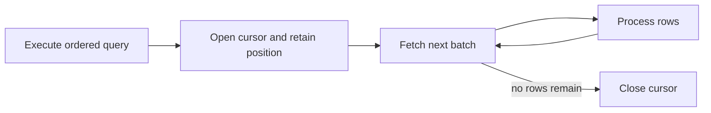

🗓️ 06072026 1200

# database_cursor

A **database cursor** represents a position in a query result so a client or stored program can fetch rows incrementally. Cursor behavior is database-specific: some cursors are materialized, some stream rows, and their lifetime may be tied to a transaction or session.

## When to use one

- A stored procedure needs row-by-row procedural logic.
- A client driver streams a large result without buffering it all at once.
- A workflow needs a database-defined cursor position within a transaction.

## Costs and boundaries

- Cursors can hold server, connection, or transaction resources while open.
- Some implementations materialize results, which can use memory or temporary storage.
- Snapshot and locking behavior depend on the database, cursor type, and transaction isolation.
- A cursor is not automatically a safe API pagination token.

Prefer set-based SQL when the operation can be expressed as a query or bulk update. For stateless API pagination, see [[keyset_cursor]]. MySQL's stored-program behavior is covered in [[cursor]].

## References

- [MySQL 8.4: Cursor restrictions](https://dev.mysql.com/doc/refman/8.4/en/cursor-restrictions.html)
- cursor
- keyset cursor
