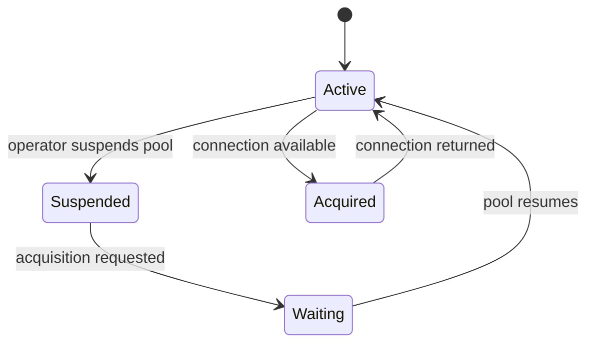

🗓️ 03092024 1125

# pool_suspension

HikariCP can suspend a pool when `allowPoolSuspension` is enabled. While suspended, calls to `getConnection()` wait until the pool resumes; they do not follow the normal connection-acquisition timeout.

## When it can help

- Coordinate a controlled database failover.
- Pause new pool borrowers while an operator performs maintenance.
- Resume the pool after the dependency is ready.

## Operational risks

- Waiting request threads can accumulate while the pool is suspended.
- A suspended pool does not cancel connections already borrowed by application code.
- Every suspend path needs a reliable resume action, including failure handling.
- Use request deadlines and upstream backpressure; pool suspension alone does not provide them.

This is a HikariCP feature, not a universal connection-pool behavior. It is disabled by default and can be controlled through JMX when enabled. Do not set `maximumPoolSize` to zero to suspend the pool.

## References

- [HikariCP: Configuration](https://github.com/brettwooldridge/HikariCP#configuration-knobs-baby)
- [[timeout_configs]]
