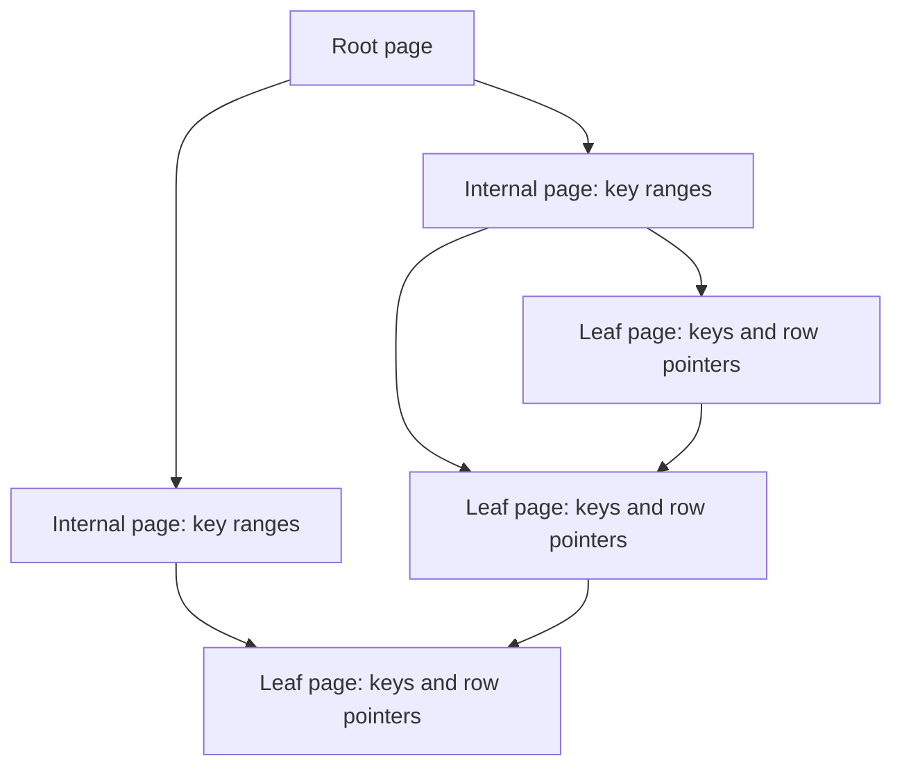

🗓️ 06112024 0011

# b_plus_tree

 A **B+ tree** is a balanced multiway search tree commonly used for disk-based indexes. Its internal nodes guide search; leaf nodes store keys and row references or records.



## Structure and Properties
- Leaf nodes
	- store actual data
	- linked together, facilitating **efficient sequential access and range queries**
- Internal nodes
	- Contain only keys
	- Pointers to other nodes
	- Serve as **guides** to navigate through the tree but do not store data themselves

```ad-note
Allows for more keys to be stored in internal nodes, reducing the tree's height
```
## Operations
### Search
1. Start at the root and compare the search key with separator keys.
2. Follow the child pointer for the key's range.
3. Continue until the matching leaf, where the indexed entry is found.
### Insert
1. Find the target leaf and insert the key in order.
2. If the leaf overflows, split it and update its parent separator.
3. Propagate splits upward when an internal node also overflows.

### Deletion
1. Remove the key from its leaf.
2. If a node falls below its occupancy requirement, redistribute keys or merge nodes.
3. Update parent separators and preserve the leaf-level links.

---

## References
- [MySQL 8.4: InnoDB physical structure](https://dev.mysql.com/doc/refman/8.4/en/innodb-physical-structure.html)
