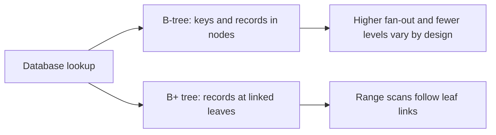

🗓️ 06112024 0018

# b_trees_comparisons

Both B-trees and B+ trees keep keys ordered in a balanced multiway tree. The main distinction is where records or row references live and how leaves support range scans.

| Property | B-tree | B+ tree |
|---|---|---|
| Internal nodes | May store keys and records or record pointers | Store separator keys and child pointers |
| Leaves | Hold remaining records or pointers | Hold all record entries and are commonly linked |
| Point search | May finish at an internal node or a leaf | Reaches a leaf |
| Range scan | In-order traversal | Sequential leaf traversal is efficient |

Actual database index structures vary. See [[b_tree]] and [[b_plus_tree]] for their operations.

## References

- [Database System Concepts, 7th edition](https://www.db-book.com/)
