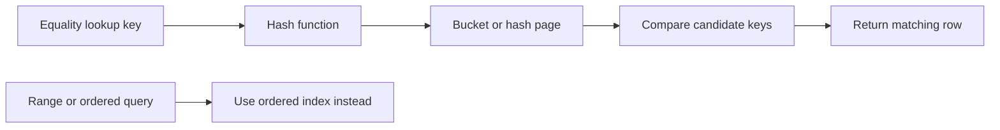

🗓️ 27012025 0105

# hash_indexes

A **hash index** maps a key to a bucket using a hash function. It can support equality lookups; it does not preserve key order for range scans.

## When it fits

- Queries search for equality on an indexed value.
- Ordered traversal and range predicates are not needed from that index.

## Boundaries

- Hash collisions require the index to compare candidate keys within a bucket.
- Performance depends on the engine's implementation, load, and collision handling.
- Support for uniqueness, WAL, crash recovery, and planner use varies by database.
- A hash index does not guarantee constant-time disk access; pages can still require I/O.

Compare with [[b_plus_tree_indexes]], which supports ordered scans and ranges.

## References

- [PostgreSQL: Hash indexes](https://www.postgresql.org/docs/current/hash-index.html)
- b plus tree indexes
