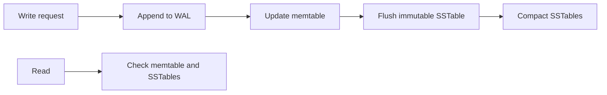

🗓️ 27012025 0117

# lsm_trees

An **LSM tree** buffers writes in memory and flushes sorted batches to immutable files called [[sstables]]. It favors write throughput by turning many small updates into sequential file writes.

## Write path

1. Append the mutation to a write-ahead log when durability requires it.
2. Apply it to an in-memory sorted structure, commonly a memtable.
3. Flush a full memtable as a new sorted file.
4. Compact files in the background to control their count and remove obsolete versions.

The WAL and acknowledgment policy determine which writes survive a crash. A WAL alone does not guarantee durability unless the system has persisted it according to its configured guarantees.

## Read path

The engine checks recent in-memory data and relevant on-disk files, then chooses the newest value. Bloom filters, indexes, and compaction can reduce reads, but read amplification remains a design trade-off.

## Trade-offs

- Batches writes and avoids many random in-place updates.
- Compaction consumes I/O and CPU and can create write amplification.
- Reads may consult multiple files, increasing read amplification.
- Space amplification can occur while old and compacted files coexist.

RocksDB, LevelDB, and Cassandra use LSM-based designs with implementation-specific policies. Compare with [[b_plus_tree_indexes]].

## References

- Martin Kleppmann, *Designing Data-Intensive Applications*, chapter 3.
- sstables
