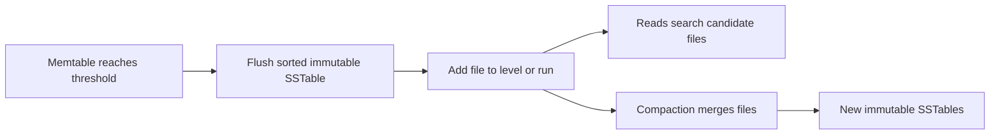

🗓️ 27012025 0108

# sstables

An **SSTable** (sorted string table) is an immutable file containing sorted key-value entries. An engine can use its ordering to seek to a key or scan a range.

## Why immutability helps

- The file is written once rather than updated in place.
- Sorted entries support efficient range reads.
- Multiple files can be merged into a larger sorted file during compaction.

An SSTable is a storage component, not a complete database. The engine still needs indexes, version rules, deletion markers, and a recovery strategy. [[lsm_trees]] describes how LSM databases combine SSTables with in-memory writes and compaction.

## References

- Martin Kleppmann, *Designing Data-Intensive Applications*, chapter 3.
- lsm trees
