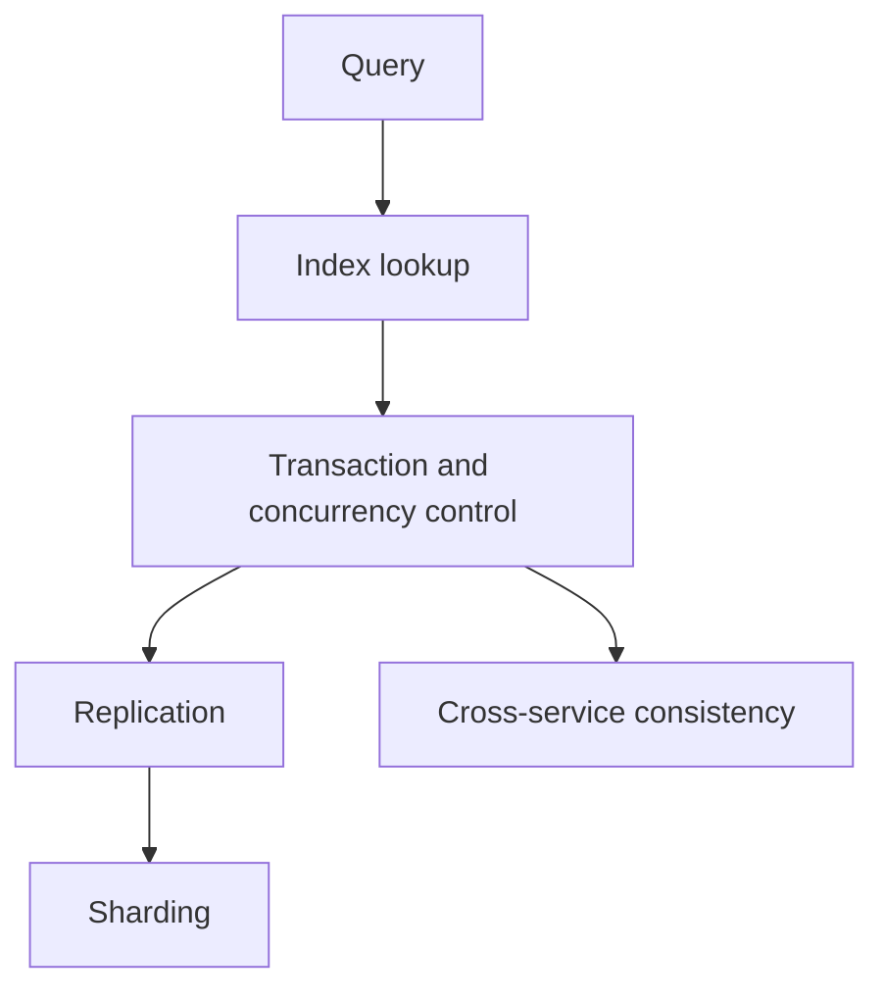
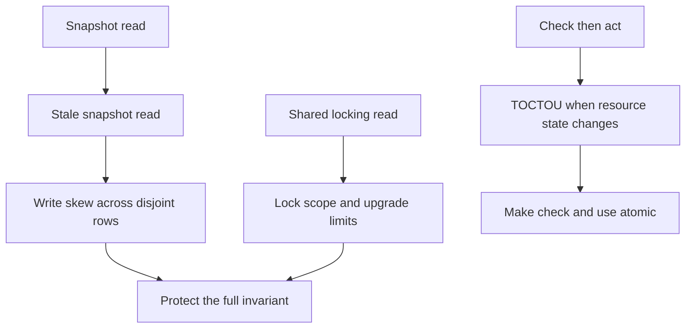

🗓️ 29042026 1830

# concepts

> Map of Content for the database-internals concept cluster. Covers indexing, transactions, replication, sharding, and cross-service consistency patterns.

## Concept Order

### Indexing
1. [[b_plus_tree_indexes]] — the structure beneath every relational index.
2. [[composite_index_leftmost_prefix]] — when a multi-column index actually fires.

### Transactions and Concurrency
3. [[ACID]] — the four properties (existing).
4. [[concurrency_control]] — pessimistic vs optimistic; the framing (existing).
5. [[isolation_levels]] — RU/RC/RR/Serializable plus the anomaly matrix.
6. [[mvcc_innodb_read_view]] — how InnoDB implements RC and RR via snapshots.
7. [[innodb_locks]] — gap and next-key locks; the phantom-prevention mechanism (existing).
8. [[write_skew]] — why stable snapshots can still violate cross-row invariants.

### Common Concurrency Pitfalls

Use this map to trace a stale observation, a lock choice, or a check/action gap to its failure mode.

The database cases are developed in [[write_skew]], [[mvcc_innodb_read_view]], and [[innodb_locks]]. The broader race pattern is in [[check_then_act]] and its security-specific form in [[time_of_check_to_time_of_use]].

### Replication
9. [[replication_async_sync_semi]] — three modes, replication lag, failover behaviour.

### Sharding
10. [[sharding_strategies]] — range / hash / directory plus shard-key selection.
11. consistent hashing — minimum-data-movement sharding (cross-link to distributed-systems cluster).

### Cross-Service Consistency Patterns
12. [[two_phase_commit]] — the textbook protocol and why teams avoid it.
13. [[saga]] — choreography vs orchestration, compensating actions.
14. [[outbox]] — the dual-write fix; bridges into messaging.

### Planned
- `covering_index_index_pushdown` — covering indexes plus ICP optimisations.
- `binlog_redolog_undolog` — the "three logs" of InnoDB and how they cooperate.
- `phantom_read_gap_next_key_lock` — depth on InnoDB locking modes.
- `read_write_splitting_replication_lag` — application-side patterns to live with replicas.
- `query_explain_optimization` — reading EXPLAIN output systematically.

## How to Use This MOC

- **First pass**: walk top-to-bottom; skip nothing. Indexing and isolation feed everything else.
- **Second pass**: pick three random entries, do a 5-minute self-explain. Note where the explanation stalls — those are the zettels to revisit.
- **Application drill**: pair this MOC with a system design prompt. Most non-trivial designs hinge on choices from this list — sharding scheme, isolation level, replication mode, dual-write handling.
- **Tag hygiene**: drop `#wip` once a zettel is revised and stable.

## Bridges to Other Domains

- → Distributed systems: moc distributed systems — CAP, quorum, consistency models, Raft.
- → Caching: [[cluster_topology]], `redis_distributed_lock` *(planned)* — cache + DB consistency.
- → Messaging: [[queue]], [[exactly_once_semantics]] — outbox feeds these.
- → Spring/Java: `spring_transaction_propagation` *(planned)*, `spring_aop_proxies_jdk_vs_cglib` *(planned)* — `@Transactional` semantics.
