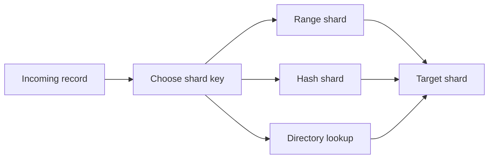

🗓️ 29042026 1730

# database_sharding_strategies

> The three (and a half) ways to split a dataset across nodes when one machine isn't enough. Choice of strategy and shard key shape every cross-shard pain you'll hit later — and the wrong choice is expensive to undo.



## Vertical vs Horizontal

```ad-abstract
**Vertical partitioning** — place different tables or columns on separate databases or storage groups.
**Horizontal sharding** — split rows from the same logical dataset across shards.
```

Vertical partitioning and service decomposition can be combined, but they solve different problems. This note focuses on horizontal sharding.

## The Three Horizontal Strategies

### 1. Range-based

Partition the keyspace into contiguous ranges, one range per shard.

```
shard A: user_id [    0,  10M)
shard B: user_id [10M,   20M)
shard C: user_id [20M,   30M)
```

**Pros**: range scans hit one or few shards (`WHERE user_id BETWEEN 5M AND 7M` → shard A only). Easy to reason about.

**Cons**: hot ranges. If new users (high IDs) are most active, shard C burns while A and B idle. Auto-incrementing PKs make this worse.

**Used in**: BigTable, HBase, MongoDB ranged shard key.

### 2. Hash-based

`shard = hash(key) mod N`. Distributes load evenly.

**Pros**: even distribution by construction. Hot keys still possible but no hot ranges.

**Cons**:
- Adding a node remaps `~(N-1)/N` of keys → see consistent hashing for the fix.
- Range scans become **scatter-gather** — query every shard, merge results.
- Co-located reads (e.g. all of one user's data) require careful key design.

**Used in**: Cassandra, ShardingSphere `MOD` algorithm, classic Memcached client routing.

### 3. Directory / Lookup

A separate service maps each key to a shard. The map is the source of truth; you can split, merge, or move shards arbitrarily.

```
lookup_service.find_shard(user_id=42) → "shard B"
```

**Pros**: maximum flexibility. Reshard any time without rehashing.

**Cons**: extra hop on every query (cache it). Lookup service is a SPOF if not HA. More moving parts.

**Used in**: Vitess (its `vschema`), Foursquare's MongoDB sharding, custom homegrown systems.

### Geographic or tenant-based placement

Choose a region or tenant as the placement key. This can support locality or isolation goals, but does not by itself ensure regulatory compliance or prevent noisy-neighbor effects.

```
EU users → shard EU
US users → shard US
TenantA → dedicated shard A
```

Common in B2B SaaS for compliance (GDPR), latency, or noisy-neighbour isolation.

## Choosing a Shard Key

The hardest decision in sharding. Once chosen, hard to change.

Evaluation criteria:

| Criterion             | What to ask                                                      |
|-----------------------|------------------------------------------------------------------|
| **Cardinality**       | Enough distinct values to spread across N shards?                |
| **Frequency / hotness** | Are some values vastly more common (celebrity user_id)?         |
| **Query alignment**   | Do hot queries filter by this key (so they hit one shard)?       |
| **Co-location need**  | Are related rows reachable via this key (user_id co-locates user's posts)? |
| **Monotonicity**      | If always-increasing (timestamps, auto-IDs), expect range hot-spots. |

Common choices: `user_id`, `tenant_id`, `region`, `entity_id`. Avoid: `created_at` (range hotspot), `status` (low cardinality), boolean flags.

## Cross-Shard Queries

The bane of sharding.

| Pattern             | Cost                                                              |
|---------------------|-------------------------------------------------------------------|
| Single-shard read   | One shard. Cheap.                                                 |
| Scatter-gather read | All N shards, merge. Slowest shard caps latency.                  |
| Cross-shard JOIN    | Requires data movement or a distributed join; cost and support depend on the engine. |
| Cross-shard txn     | [[two_phase_commit]] or [[saga_pattern]]. Both have downsides.    |

Listing rows across shards (e.g. all orders by status) typically becomes one of: secondary index per shard plus aggregator service running scatter-gather, or an async pipeline (CDC → search index like Elasticsearch) that owns the cross-shard view separately.

## Resharding

Adding capacity is the biggest operational pain.

- **Range**: split a range. Move only the data in the new sub-range.
- **Hash mod N → mod (N+1)**: rehash everything. Avoid via consistent hashing or fixed-slots scheme.
- **Consistent hashing**: adding a node moves a fraction of keys; the fraction depends on ring design and virtual-node count.
- **Fixed slots** (Redis Cluster's 16384, Vitess's vstreams): move slot ownership, not data hashing.
- **Directory**: update the map. Simplest in theory; hardest if data must physically migrate.

## Common Pitfalls

- **Sharding by `user_id` is the common starting point for B2C** — but its failure modes (celebrity users, cross-user analytics, abandoned-account shards) all need separate plans.
- **A wrong shard key is expensive to fix** — dual-write to the new sharding scheme, backfill, then cut over. Months of work. Choose carefully up-front.
- **Cross-shard JOINs need an explicit plan** — use a distributed join, denormalise, pre-aggregate, or build an analytical view when engine support or cost is unsuitable.
- **Uniqueness constraints across shards are only enforceable in-shard** — for global uniqueness: pre-allocated ID ranges, a central allocator, or UUIDs (with the trade-off that random UUIDs hurt range scans).
- **Vertical partitioning only delays the problem** — eventually a single feature's data outgrows one box, and you're back to horizontal sharding.

For fixed-slot variant, see [[cluster_topology]].

---

## References

- "Designing Data-Intensive Applications" ch. 6
- Vitess docs: [Sharding](https://vitess.io/docs/user-guides/configuration-basic/sharding/)
- ShardingSphere docs: [Sharding Algorithms](https://shardingsphere.apache.org/document/current/en/dev-manual/sharding/)
