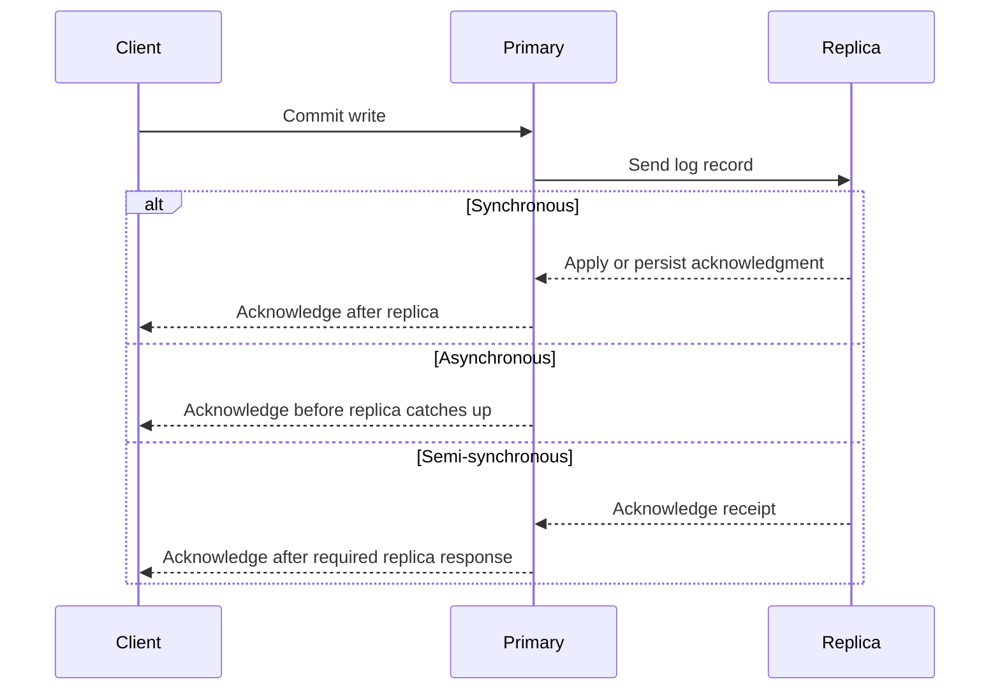

🗓️ 29042026 1715

# replication_async_sync_semi

Replication acknowledgment modes trade commit latency against how much replicated data may be missing after a failure. Exact guarantees depend on what the replica acknowledges, when it applies the data, and which replica is promoted.



## The Three Modes

```ad-abstract
**Asynchronous** — the leader can acknowledge a commit before replicas confirm it.
**Synchronous** — the leader waits for acknowledgments from the configured replica set or quorum.
**Semi-synchronous** — the leader waits for a minimum replica acknowledgment, then responds.
```

| Mode | Commit latency | Failure exposure |
|---|---|---|
| Async | Does not wait for replica acknowledgment. | Recent acknowledged writes may be absent from a promoted replica. |
| Semi-sync | Waits for the configured acknowledgment condition. | Depends on whether the acknowledgment means received, persisted, or applied, and on failover selection. |
| Synchronous | Waits for the configured replica set or quorum. | Can reduce loss within the protocol's stated failure model; does not mean every failure is covered. |

## When Each Is Used

- **MySQL default**: async. Simple, fast, accepts data-loss risk on failover.
- **MySQL semi-synchronous replication**: opt-in. An acknowledgment does not mean the replica has applied the event; timeout or loss of acknowledgers can cause fallback behavior.
- **PostgreSQL `synchronous_standby_names`**: configurable list, supports `ANY n` (semi-sync-style) and `FIRST n` (priority-based).
- **Spanner / CockroachDB**: synchronous via Paxos/Raft quorum (W = majority).
- **Galera / InnoDB Cluster**: synchronous multi-write via group communication.

## What "Synchronous" Actually Means

Synchronous replication can wait for all configured replicas or a quorum, depending on the product. Waiting for more replicas can increase latency and reduce availability when a replica is slow. See quorum reads writes for quorum reasoning.

For MySQL semi-synchronous replication, a replica may acknowledge receipt before applying the event. A read from that replica can therefore still be stale.

## Replication Lag

Async + semi-sync replicas apply changes after they're received. The delay = **replication lag**. Sources:

- Network RTT between leader and replica.
- Replica's apply throughput (single-threaded SQL apply was MySQL's classic bottleneck — fixed somewhat by parallel apply since 5.7).
- Replica is also serving reads — apply gets queued.

Lag → **read-after-write inconsistency**: write to leader, read from replica, don't see your own write. Mitigations:

- Read your own writes from leader.
- Wait for the replica to reach a required log position using the engine's supported mechanism.
- Stick the user to one replica (sticky sessions).
- Use synchronous reads from leader for sensitive paths.

## Logical vs Physical

- **Physical** (Postgres WAL streaming, MySQL row-based binlog): bytes-level replay. Tight coupling between versions; replicas are byte-identical.
- **Logical** (statement-based, or logical decoding output): replays high-level changes. Loose coupling; can replicate across major versions or different schemas. Used for CDC tools (Debezium reads MySQL row-based binlog; Postgres logical decoding feeds it).

MySQL binlog has three formats: STATEMENT, ROW, MIXED. ROW is the production default — deterministic, no nondeterministic-function issues.

## Replication Topologies

| Topology         | Description                                          | Used in                  |
|------------------|------------------------------------------------------|--------------------------|
| Single-leader    | One writer, N readers. Most common.                   | MySQL/Postgres default   |
| Multi-leader     | Multiple writers, conflict resolution required.       | Multi-region setups, BDR |
| Leaderless       | All nodes accept writes; quorum reads/writes.         | Cassandra, Dynamo        |

## Failover

- **Async + leader crash** → some acknowledged writes may be absent from the chosen replica.
- **Semi-sync + crash** → an acknowledging replica may have the event, but recovery depends on acknowledgment semantics and promotion policy.
- **Synchronous + crash** → the protocol's guarantee depends on its quorum, persistence, and failure assumptions.

Split brain risk during failover: old leader doesn't know it lost the role and accepts writes. Mitigations: fencing tokens, lease timeouts, STONITH ("shoot the other node in the head").

## Common Pitfalls

- **Async replication is not zero-loss failover** — define whether losing acknowledged writes is acceptable.
- **Semi-sync fallback changes the guarantee** — check timeout behavior and monitoring for the deployed version.
- **Synchronous replication can reduce availability** — commit waits depend on network and replica health.
- **Reading your own writes from a replica** has no zero-cost answer — wait for the replica to catch up to the leader's position, read from the leader, or pin the session to one replica.
- **Parallel apply is tricky** — out-of-order replay can violate constraints. MySQL keys parallelism on schema or per-database to bound the race.

For quorum-based "synchronous" replication done right, see raft. For async = AP-leaning, sync-quorum = CP-leaning, see cap theorem.

## Planned

- `read_write_splitting_replication_lag` *(planned)* — application-side patterns.

---

## References

- "Designing Data-Intensive Applications" ch. 5
- MySQL 8.4 docs: [Semisynchronous replication](https://dev.mysql.com/doc/refman/8.4/en/replication-semisync.html)
- PostgreSQL docs: [Synchronous Replication](https://www.postgresql.org/docs/current/warm-standby.html#SYNCHRONOUS-REPLICATION)
