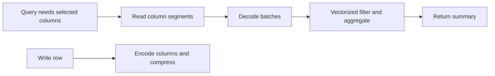

🗓️ 31012025 1721

# column_oriented_storage

**Column-oriented storage** groups values by column rather than storing every field of one row together. A query that reads a few columns across many rows can skip unrelated columns.

| ID | Name | Age | Salary |
|---|---|---:|---:|
| 1 | Alice | 30 | 100k |
| 2 | Bob | 35 | 120k |
| 3 | Carol | 28 | 95k |

Conceptually, storage groups values as `[1, 2, 3]`, `[Alice, Bob, Carol]`, `[30, 35, 28]`, and `[100k, 120k, 95k]`.

## Why it helps analytics

- A query such as `AVG(salary)` can read the salary column without reading every row field.
- Similar values often compress well, though the result depends on data and encoding.
- Column statistics can help a query engine skip irrelevant data ranges.

## Costs

- Reconstructing a full row can require reading several column groups.
- Frequent point updates may be less efficient than in a row-oriented engine, depending on the storage format.
- Row and column layouts can coexist in one system.

Columnar storage often suits [[olap]] workloads; [[row_oriented_storage]] often suits point reads and writes. These are workload tendencies, not guarantees.

## References

- olap
- row oriented storage
