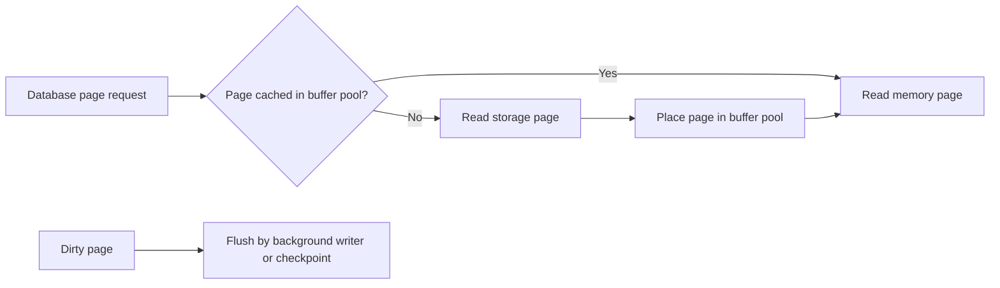

🗓️ 22012025 2351

# db_disk_management

Database storage engines organize data to balance read cost, write cost, space, and recovery. Start with the access pattern, then compare index and file structures.

## Read path

- [[hash_indexes]] support equality lookups when order is unnecessary.
- [[b_plus_tree_indexes]] support ordered keys and range scans.
- [[lsm_trees]] buffer writes and use [[sstables]] for sorted on-disk data.

## Design questions

- Are reads mostly point lookups, ranges, or scans of selected columns?
- How much write amplification and compaction work can the system tolerate?
- What durability and recovery guarantees must an acknowledged write meet?
- How do indexes, compression, and cache fit the workload?

No storage structure is fastest for every workload. Benchmark representative data and query patterns before choosing or tuning an engine.

## References

- Martin Kleppmann, *Designing Data-Intensive Applications*, chapter 3.
- hash indexes
- b plus tree indexes
- lsm trees
