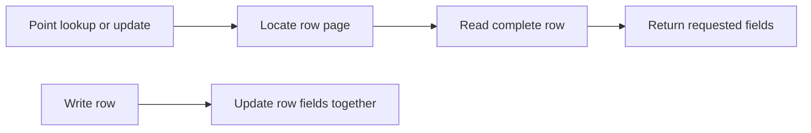

🗓️ 31012025 1637

# row_oriented_storage

**Row-oriented storage** keeps the fields of a record together. A query that reads or updates a small number of complete records can access those fields with few reads.

| ID | Name | Age | Salary |
|---|---|---:|---:|
| 1 | Alice | 30 | 100k |
| 2 | Bob | 35 | 120k |
| 3 | Carol | 28 | 95k |

Conceptually, rows are stored as `[1, Alice, 30, 100k]`, `[2, Bob, 35, 120k]`, and `[3, Carol, 28, 95k]`.

## Strengths and costs

- Point reads and updates can access a record's columns together.
- Writes that change one row do not need to read every table column.
- Analytical scans that use only a few columns may read unrelated fields.
- Compression and performance depend on page layout, indexes, and database implementation.

Row-oriented storage often suits [[oltp]] access patterns. [[column_oriented_storage]] often suits wide analytical scans. Some systems support both layouts.

## References

- oltp
- column oriented storage
