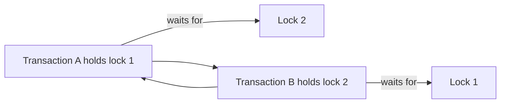

🗓️ 02032025 0116

# coffman_conditions

The Coffman conditions describe four conditions that must hold together for a resource deadlock in the classic model. Removing any one condition prevents that form of deadlock.

| Condition | Meaning |
|---|---|
| Mutual exclusion | At least one resource can be held by only one process at a time. |
| Hold and wait | A process holds one resource while waiting for another. |
| No preemption | A resource cannot be forcibly reclaimed; its holder must release it. |
| Circular wait | Processes form a cycle, each waiting for a resource held by the next. |

In database applications, acquiring locks in a consistent order can prevent circular wait. A timeout or abort can release held locks and break a wait, but it handles a deadlock rather than proving the design deadlock-free.

## References

- Silberschatz, Galvin, and Gagne, *Operating System Concepts*, chapter on deadlocks.
