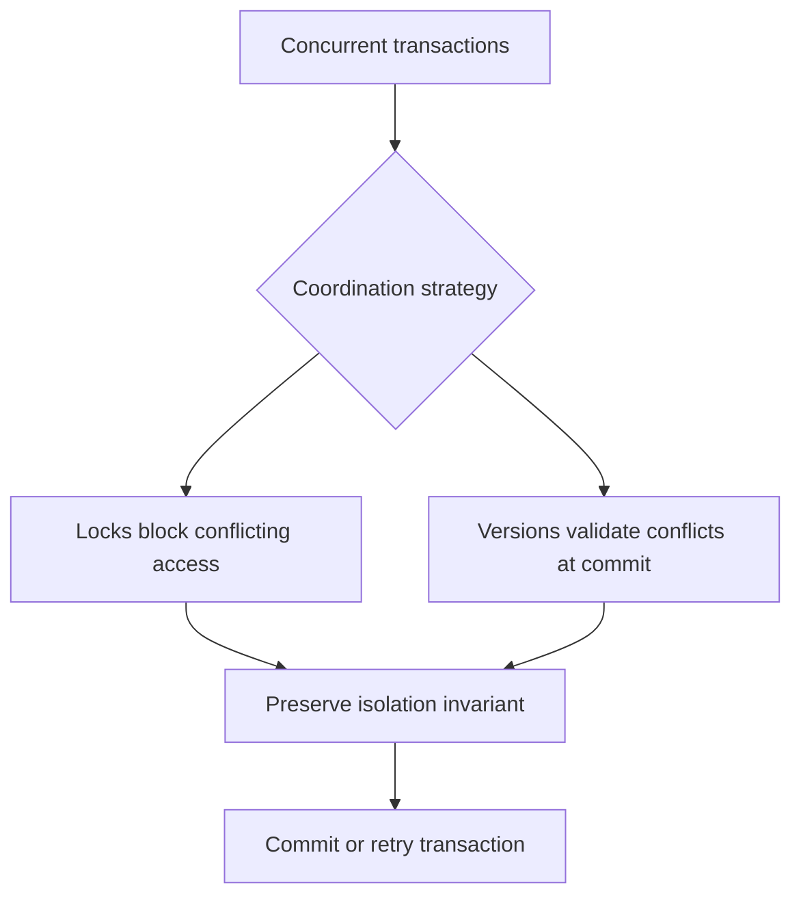

🗓️ 07082025 1049

# concurrency_control

**Concurrency control** coordinates simultaneous transactions so their committed effects satisfy the database's correctness rules. It includes isolation, conflict detection, locking, and recovery behavior.

## Common anomalies

| Anomaly | What happens |
|---|---|
| Lost update | One transaction overwrites another transaction's change. |
| Dirty read | A transaction reads data another transaction has not committed. |
| Non-repeatable read | Re-reading a row returns a changed value after another transaction commits. |
| Phantom read | Re-running a predicate query returns a different set of rows. |

Which anomalies are possible depends on the database and isolation level. See [[isolation_levels]] and [[phantom_reads]].

## Conflict strategies

- **Pessimistic locking:** lock data before changing it. Contenders wait or fail; see [[pessimistic_locking]].
- **Optimistic validation:** allow work to proceed, then reject a conflicting commit. Callers may need to retry; see [[optimistic_locking]].
- **MVCC:** keep versions so readers can use a consistent view while writers proceed. See [[mvcc_innodb_read_view]].

These strategies are not mutually exclusive. A database can combine them across operations and isolation levels. Measure contention and define retry behavior rather than assuming one strategy is always faster.

## References

- [PostgreSQL: Transaction isolation](https://www.postgresql.org/docs/current/transaction-iso.html)
- transaction isolation levels
