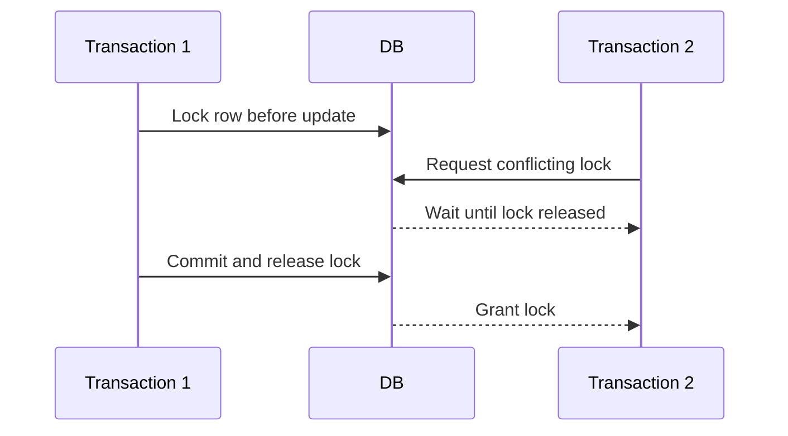

🗓️ 07082025 1052

# pessimistic_locking

**Pessimistic locking** acquires a lock before changing data. Conflicting transactions wait, fail, or time out according to the database and statement configuration.

```sql
BEGIN;
SELECT balance FROM account WHERE id = 7 FOR UPDATE;
UPDATE account SET balance = 90 WHERE id = 7;
COMMIT;
```



## Trade-offs

- Prevents another transaction from changing the locked row during the critical section.
- Can simplify decisions when conflicts are frequent or expensive to retry.
- Holds database resources while the transaction remains open.
- Poor lock ordering or long transactions can cause waits and deadlocks.

Lock scope, isolation behavior, and supported syntax vary by database. Keep the transaction short and handle deadlock or timeout errors. Compare [[optimistic_locking]] and [[innodb_locks]].

## References

- [PostgreSQL: Explicit locking](https://www.postgresql.org/docs/current/explicit-locking.html)
- [[concurrency_control]]
