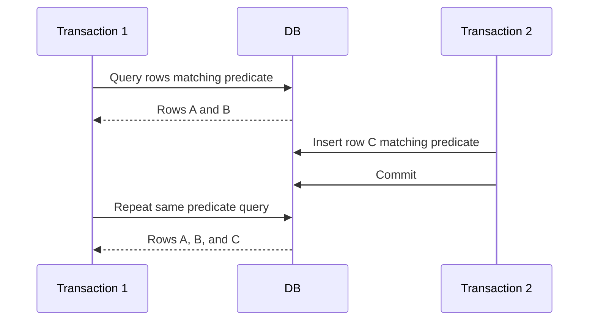

🗓️ 02032025 0120

# phantom_reads

A **phantom read** occurs when a transaction repeats a predicate query and sees a different set of rows because another transaction committed rows matching that predicate.

Example: transaction A runs `SELECT * FROM orders WHERE total > 100`. Transaction B inserts an order with `total = 150` and commits. If A repeats the query and sees that row, it observed a phantom.

Phantoms differ from a non-repeatable read, where the same row returns a changed value. Database behavior depends on isolation and execution model: a locking implementation may protect a key range, while snapshot isolation can keep the transaction's read view unchanged.

See [[transaction_isolation_levels]] and [[innodb_locks]] for engine-specific behavior.

## References

- [PostgreSQL: Transaction isolation](https://www.postgresql.org/docs/current/transaction-iso.html)
- [MySQL 8.4: InnoDB transaction isolation](https://dev.mysql.com/doc/refman/8.4/en/innodb-transaction-isolation-levels.html)
