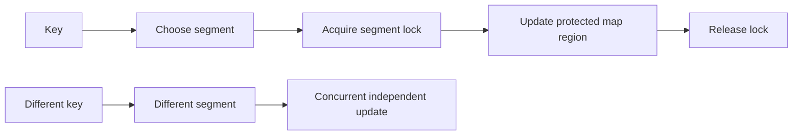

🗓️ 19082025 1445

# segmented_locking

**Segmented locking** divides a shared structure into regions protected by separate locks. Operations on different regions can proceed concurrently; operations on the same region still contend.

## Trade-offs

- More independent locks can reduce contention when operations target different regions.
- A hot region still serializes its callers.
- Rehashing, resizing, and operations spanning multiple regions need coordination.
- Lock count and memory overhead increase with finer segmentation.

## ConcurrentHashMap history

Older JDK implementations divided `ConcurrentHashMap` into fixed segments. Java 8 replaced that structure with a table of bins and finer-grained coordination, including compare-and-set operations and synchronization on individual bins when needed. Retrievals generally do not lock.

Do not assume current `ConcurrentHashMap` has 16 or 64 configurable segments. See [[concurrency_data_structures]] for the current collection choices.

## References

- [Java 8: ConcurrentHashMap API](https://docs.oracle.com/javase/8/docs/api/java/util/concurrent/ConcurrentHashMap.html)
- [OpenJDK: ConcurrentHashMap source](https://github.com/openjdk/jdk/blob/master/src/java.base/share/classes/java/util/concurrent/ConcurrentHashMap.java)
