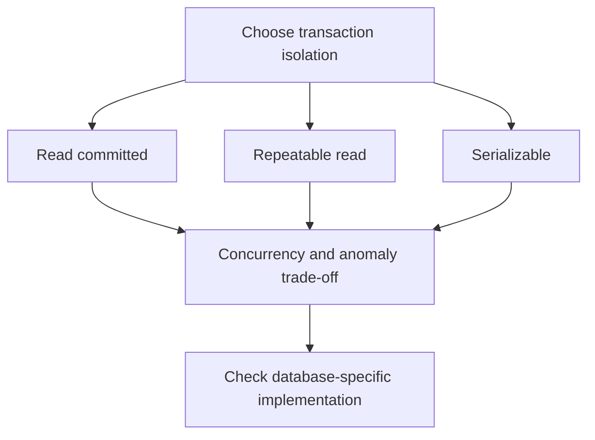

🗓️ 29042026 1700

# transaction_isolation_levels

An isolation level defines which effects concurrent transactions may observe. The SQL standard names four levels, but database engines can provide stronger behavior or implement a level differently.

## Anomalies

| Anomaly | Meaning |
|---|---|
| Dirty read | Read a value another transaction has not committed. |
| Non-repeatable read | Read the same row twice and observe another transaction's committed change. |
| Phantom read | Repeat a predicate query and observe a different matching row set. |
| Lost update | One concurrent update overwrites another update. This is not one of the standard phenomena used to define the four levels. |
| Write skew | Transactions read overlapping data and update different rows, jointly violating an invariant. This can occur under snapshot isolation. |

## SQL standard levels

| Level | Dirty reads | Non-repeatable reads | Phantoms |
|---|---|---|---|
| Read Uncommitted | Possible | Possible | Possible |
| Read Committed | Prevented | Possible | Possible |
| Repeatable Read | Prevented | Prevented | Allowed by the standard |
| Serializable | Prevented | Prevented | Prevented; results match a serial order |

Lost updates and write skew need separate consideration. A system may prevent them with write-conflict detection, locks, constraints, or serializable execution.

## Engine behavior

- **MySQL InnoDB 8.4:** defaults to Repeatable Read. Ordinary consistent reads use a snapshot; locking reads and writes may use record, gap, or next-key locks.
- **PostgreSQL:** defaults to Read Committed. Repeatable Read uses a transaction snapshot and prevents phantom reads, but serialization anomalies can still occur. Serializable may abort transactions that cannot be safely serialized.
- **SQL Server:** Read Committed is the default. Snapshot is a separate mode; locking behavior depends on database options and statement context.
- **Oracle:** Read Committed is the default; Serializable is also available. Do not map vendor names directly to a different engine's behavior.

Defaults and behavior can change by product, version, and configuration. Read the engine documentation and test the exact statements your application uses.

## Choosing a guarantee

- Use constraints for invariants the database can express.
- Use explicit locking when a transaction must protect a row or range while deciding.
- Use version checks when callers can detect and retry conflicts.
- Use Serializable when the invariant spans data that lower levels cannot safely protect; handle serialization failures.

See [[ACID]], [[concurrency_control]], [[mvcc_innodb_read_view]], [[innodb_locks]], and [[phantom_reads]].

## References

- [MySQL 8.4: InnoDB transaction isolation](https://dev.mysql.com/doc/refman/8.4/en/innodb-transaction-isolation-levels.html)
- [PostgreSQL: Transaction isolation](https://www.postgresql.org/docs/current/transaction-iso.html)
- [Microsoft: Snapshot isolation in SQL Server](https://learn.microsoft.com/en-us/sql/connect/ado-net/sql/snapshot-isolation-sql-server?view=sql-server-ver17)
- [Oracle: Concepts](https://docs.oracle.com/database/121/CNCPT/E41396-15.pdf)
