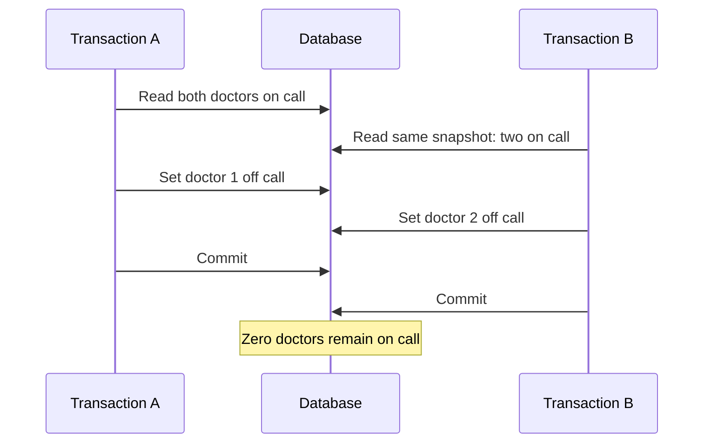

🗓️ 18102026 1625

# write_skew

> **Write skew**: A concurrency anomaly where transactions read overlapping data, update different rows, and together violate an invariant. ([PostgreSQL: Transaction Isolation](https://www.postgresql.org/docs/current/transaction-iso.html))

Write skew can occur under snapshot-based isolation because concurrent transactions may each make a valid decision from the same earlier view. Their writes do not conflict at the row level, so both can commit even though the combined result is invalid.

## How disjoint writes break an invariant

Assume a team must always have at least one doctor on call. Two doctors are on call, each represented by a row. Concurrent transactions both count two on-call doctors, then each turns a different doctor off call. Neither transaction updates the row changed by the other, so a write-write conflict does not force one to stop.

The invariant spans both rows, but the writes touch separate rows. This differs from a lost update, where competing writes overwrite the same row value. See [[isolation_levels]] for the anomaly matrix and [[mvcc_innodb_read_view]] for InnoDB snapshot behavior.

## Preventing write skew

- Encode the invariant as a database constraint when possible.
- Update a shared guard row or take exclusive locks covering the invariant.
- Use Serializable isolation and retry transactions the database aborts.

The right protection depends on what rows and predicates form the invariant. Locking only rows returned by a query may not protect a range or a row that does not exist yet; see [[innodb_locks]].

## Common misreading

Two transactions changing the same row are not automatically write skew. A conflicting update can block or fail; write skew specifically involves disjoint writes based on a related read set.

## References

- [PostgreSQL: Transaction Isolation](https://www.postgresql.org/docs/current/transaction-iso.html)
- [MySQL 8.4: InnoDB Transaction Isolation Levels](https://dev.mysql.com/doc/refman/8.4/en/innodb-transaction-isolation-levels.html)
