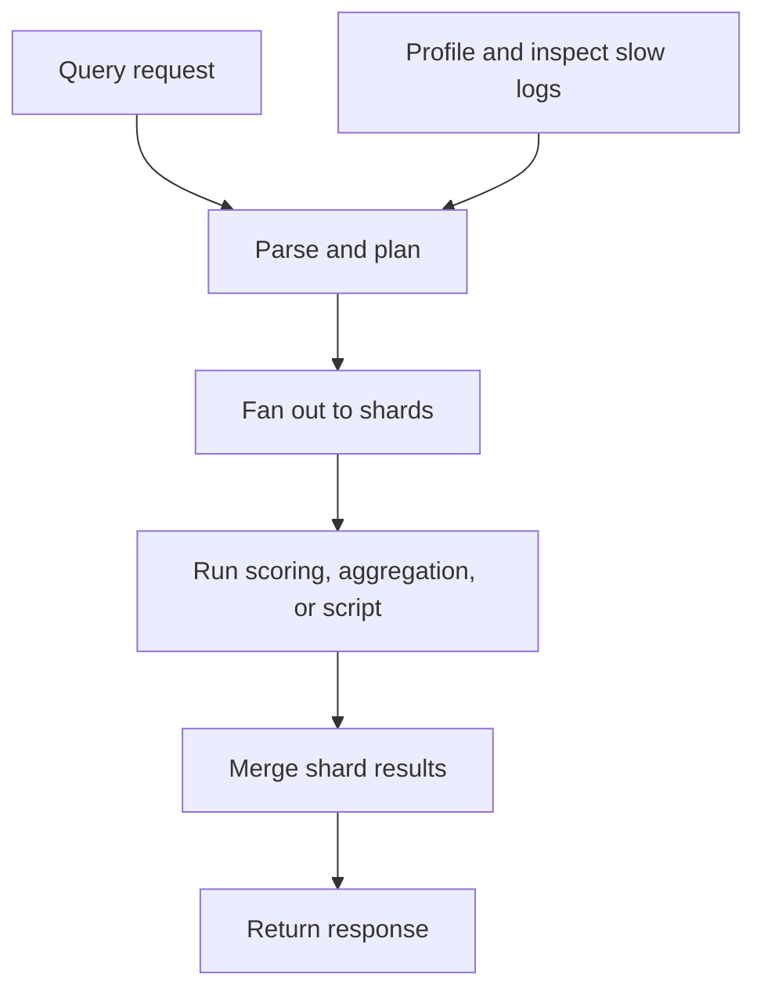

🗓️ 17102026 2135

# expensive_queries

Elasticsearch labels some query types expensive because they can scan many terms or evaluate substantial work per document.

Examples include script queries, fuzzy and regexp queries, some prefix and wildcard queries, joins, runtime fields, and ranges over `text` or `keyword` fields. Whether a query is expensive depends on field mapping and index options: for example, `prefix` can be eligible when `index_prefixes` is configured.

Expensive does not mean every request is slow. Cost depends on data, selectivity, shard layout, and competing workload. Profile representative requests, constrain broad user input, and choose field mappings for expected filters. On supported deployments, `search.allow_expensive_queries=false` rejects query classes Elasticsearch flags as expensive; it is a guardrail, not a query optimizer.

For two different prefix search behaviors, see [[prefix_vs_match_phrase_prefix]]. For query types and contexts, see [[query_dsl]]. For mapping and analysis choices, see [[analyzer_configuration]].

## References

- [Elasticsearch: Query DSL and expensive queries](https://www.elastic.co/docs/reference/query-languages/query-dsl)
