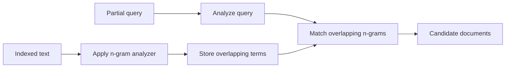

🗓️ 17102026 2135

# ngram_search

An n-gram analyzer indexes overlapping fragments of text so a query can match partial terms.

For a character `ngram` tokenizer with sizes 2–3, `quick` produces fragments such as `qu`, `ui`, `ic`, `ck`, `qui`, `uic`, and `ick`. An `edge_ngram` tokenizer emits fragments anchored at the start of each token, such as `q`, `qu`, `qui`, and `quic`; this is useful for type-ahead prefix matching.

Configure partial-word analysis on an index field and use a compatible search analyzer. N-grams increase the number of indexed terms, so index size and write cost rise. Choose `min_gram` and `max_gram` for the actual query lengths, and consider `search_as_you_type` or prefix-query features when they better fit the use case.

```json
{
  "settings": {
    "analysis": {
      "tokenizer": {
        "partial_words": { "type": "ngram", "min_gram": 2, "max_gram": 3 }
      },
      "analyzer": {
        "partial_words": { "tokenizer": "partial_words", "filter": ["lowercase"] }
      }
    }
  }
}
```

For general n-gram concept, see [[n_gram]]. For elasticsearch analysis pipeline, see [[analyzer_configuration]]. For query-time prefix options, see [[prefix_vs_match_phrase_prefix]].



## References

- [Elasticsearch: Tokenizer reference](https://www.elastic.co/docs/reference/text-analysis/tokenizer-reference)
- [Elasticsearch: Edge n-gram tokenizer](https://www.elastic.co/guide/en/elasticsearch/reference/current/analysis-edgengram-tokenizer.html)
