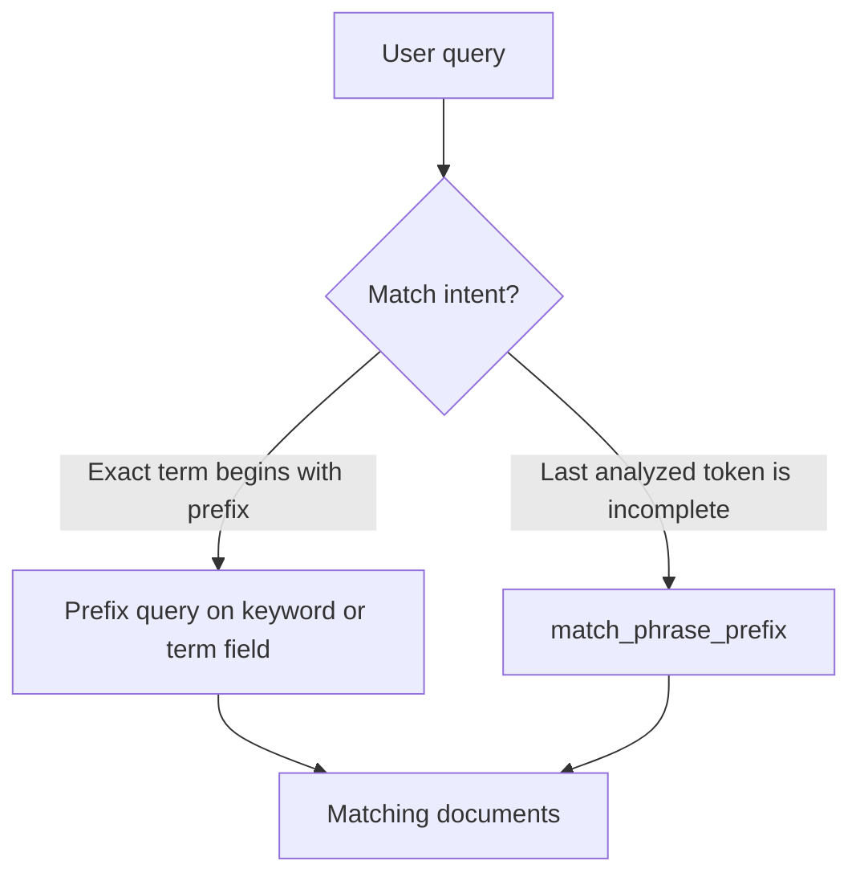

🗓️ 17102026 2125

# prefix_vs_match_phrase_prefix

Use a `prefix` query to match terms beginning with characters. Use `match_phrase_prefix` to match analyzed words in order, with the final word treated as a prefix.



## Terms

| Term | Definition | Source |
|---|---|---|
| **Prefix query** | A term-level query that matches terms beginning with a supplied character sequence. | [Elastic docs](https://www.elastic.co/docs/reference/query-languages/query-dsl/query-dsl-prefix-query) |
| **Match phrase prefix query** | A full-text query that analyzes the input and matches its terms in order, treating the final term as a prefix. | [Elastic docs](https://www.elastic.co/docs/reference/query-languages/query-dsl/query-dsl-match-query-phrase-prefix) |

## How they differ

| Query | Input handling | Matching rule | Typical use |
|---|---|---|---|
| `prefix` | Searches a term in the field's index representation. | A term starts with the supplied prefix. | Prefix lookup on keyword-like fields. |
| `match_phrase_prefix` | Analyzes the query text. | Analyzed terms appear in order; the last term is a prefix. | Phrase-style autocomplete over text. |

```json
GET /products/_search
{
  "query": {
    "match_phrase_prefix": {
      "title": "wireless head"
    }
  }
}
```

This can match an analyzed phrase such as `wireless headphones`. It does not require the prefix to match the beginning of the entire field.

## Boundaries

- `match_phrase_prefix` limits expansion of the final term. A low limit can omit an otherwise valid completion.
- Prefix queries can be expensive when many terms share the prefix. Elasticsearch can optimize configured prefixes with `index_prefixes`.
- For search-as-you-type, compare `search_as_you_type` fields and completion suggesters before choosing either query.

## References

- [Elastic: Prefix query](https://www.elastic.co/docs/reference/query-languages/query-dsl/query-dsl-prefix-query)
- [Elastic: Match phrase prefix query](https://www.elastic.co/docs/reference/query-languages/query-dsl/query-dsl-match-query-phrase-prefix)
- [Elastic: Full text queries](https://www.elastic.co/docs/reference/query-languages/query-dsl/full-text-queries)
