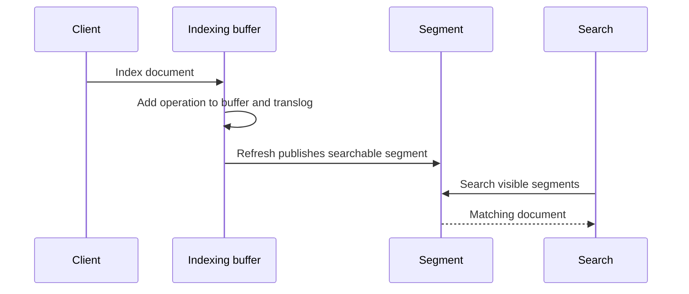

🗓️ 05102024 1201

# realtime_search

## Terms

| Term                  | Description                                                                                                                                   |
| --------------------- | --------------------------------------------------------------------------------------------------------------------------------------------- |
| lucene index          | underlying data structure that Elasticsearch uses to store and retrieve information                                                           |
| segment               | smaller part of a Lucene index   As documents are indexed, Elasticsearch splits data into multiple segments.                          |
| commit point          | snapshot of all the segments at a given point in time  **It marks the point where data has been committed and is now searchable** |
| elasticsearch refresh | refresh process in Elasticsearch ensures that newly indexed data becomes visible to search                                                    |

## How Elasticsearch Real-Time Search Works

1. **In-memory buffer**: As new documents are indexed, they are first added to an in-memory buffer.
2. **Commit Point Creation**: At certain intervals or upon manual triggering, Elasticsearch writes the in-memory buffer to disk, creating new **segments**. At this point, a **commit point** is created.
3. **Refresh Process**: After a refresh, the new segments are opened, and the indexed data becomes **searchable**.

![[es_refresh_api_lucene_index.png]]

---

## References

- https://www.elastic.co/guide/en/elasticsearch/reference/current/near-real-time.html
-
