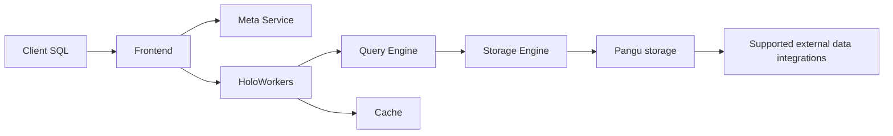

🗓️ 17102026 2135

# compute_storage_architecture

Hologres separates SQL-facing compute from its distributed storage layer, so compute capacity and stored data can scale on different paths.

| Term | Definition | Source |
|---|---|---|
| **Frontend (FE)** | The component that authenticates, parses, and optimizes SQL statements. | [Hologres architecture](https://www.alibabacloud.com/help/en/hologres/product-overview/architecture) |
| **HoloWorker** | A compute node that schedules and executes user queries. | [Hologres architecture](https://www.alibabacloud.com/help/en/hologres/product-overview/architecture) |

## Query path

1. A frontend (FE) authenticates and parses the SQL request, then plans the query.
2. HoloWorkers execute the distributed plan. Each worker includes query, storage, cache, and scheduling components.
3. The metadata service supplies table and distribution metadata.
4. The storage layer reads or writes data in Pangu; external sources such as MaxCompute or OSS can be accessed through supported integration paths.

This is a product-level mental model; exact engines, component responsibilities, and supported external sources vary by release and workload. For operations, use the architecture documentation for the deployed Hologres version.

For Hologres use cases and interface, see [[product_overview]]. For query execution, see [[query_engine]]. Alibaba's distributed storage system is described in [[pangu]]. For general architecture tradeoffs, see [[storage_disaggregation_architecture]].

## References

- [Hologres: Architecture](https://www.alibabacloud.com/help/en/hologres/product-overview/architecture)
