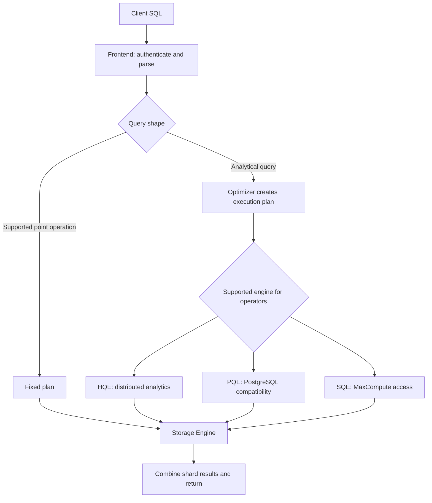

🗓️ 17102026 2215

# query_engine

Hologres routes SQL through a frontend and selects an execution path based on the operation. Query engines run plan operators across workers, then use the [[engine]] to access shard data.

| Term | Definition | Source |
|---|---|---|
| **Hologres Query Engine (HQE)** | The primary engine for analytical queries, with distributed execution and vectorized operators. | [Hologres architecture](https://www.alibabacloud.com/help/en/hologres/product-overview/architecture) |
| **PostgreSQL Query Engine (PQE)** | An engine that supports PostgreSQL-compatible operations and features. | [Hologres architecture](https://www.alibabacloud.com/help/en/hologres/product-overview/architecture) |
| **Seahawks Query Engine (SQE)** | An engine for accessing MaxCompute data from Hologres. | [Hologres architecture](https://www.alibabacloud.com/help/en/hologres/product-overview/architecture) |

## Query paths

For a supported point operation, a fixed plan can bypass general query optimization and shorten execution. For analytical queries, the optimizer builds a plan from query shape, statistics, and applicable table properties. The plan may use more than one engine for supported operators.

The engine names and routing capabilities are product-specific and can change by release. Check the deployed version's documentation before relying on a particular engine for an operator.

## Engine roles

- **HQE** runs analytical operators using distributed execution and vectorization.
- **PQE** provides PostgreSQL-compatible functionality, including supported extensions and functions.
- **SQE** supports queries over MaxCompute data without first importing it into a local table.

After execution, the engine reads or writes through storage engines on the relevant shards. The workers combine partial results and return the response to the client.

For the wider component path, see [[compute_storage]]. For shard placement and data access, see [[distribution_key]].

## References

- [Hologres: Query engine](https://www.alibabacloud.com/help/en/hologres/product-overview/qe)
- [Hologres: Architecture](https://www.alibabacloud.com/help/en/hologres/product-overview/architecture)
