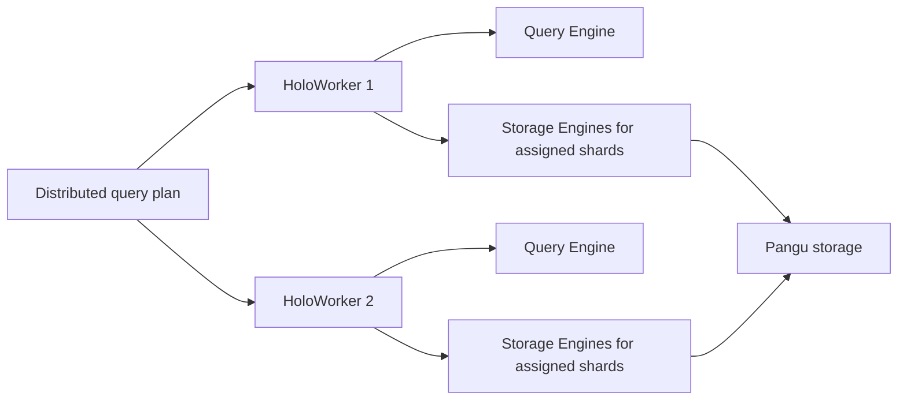

🗓️ 03022025 1348

# worker_compute_nodes

> **HoloWorker**: A Hologres compute node that schedules and executes queries. It contains query, storage, cache, and scheduling components. ([Hologres architecture](https://www.alibabacloud.com/help/en/hologres/product-overview/architecture))

HoloWorkers execute distributed plans and host storage-engine instances for assigned shards. The shard-to-worker mapping lets queries run in parallel; Alibaba manages placement and recovery details for the deployed service.



```ad-note
If you do not specify the number of table groups and shard count when you create a database, Hologres creates a default table group for you and sets the default shard count for the table group

For more information, see [Instance types](https://www.alibabacloud.com/help/en/hologres/user-guide/instance-management-types/#concept-2042629)
```

Shard count and table-group design affect parallelism and resource use. See [[table_group]] and [[shard]]; exact placement and failover behavior are service-managed.

---
## References
- [Hologres: Architecture](https://www.alibabacloud.com/help/en/hologres/product-overview/architecture)
- [Hologres: Table groups and shards](https://www.alibabacloud.com/help/en/hologres/user-guide/user-guide-of-table-groups-and-shard-counts)
