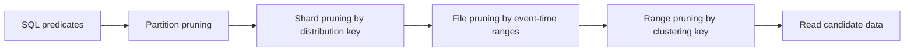

🗓️ 17102026 2222

# sql_optimization

> **Partition pruning**: Skipping table partitions that cannot match a query's partition-key predicates. ([Hologres documentation](https://www.alibabacloud.com/help/en/hologres/getting-started/hologres-index-to-get-started-quickly))

Hologres query tuning starts by reducing the data each query must inspect. Table layout helps prune partitions, shards, files, and ranges before rows reach execution operators.

## Pruning layers

- **Partitions**: A matching partition-key predicate can eliminate whole partitions. Partitioning helps only when queries constrain the partition key.
- **Shards**: A predicate on the [[distribution_key]] can route work to relevant shards. Without a shard-pruning predicate, a query may need to involve many shards.
- **Files**: A time-correlated filter can use [[segment_key]] statistics to skip files whose event-time ranges cannot match.
- **Within-file ranges**: The [[clustering_key]] can reduce reads for filters that match its leftmost key columns.

Each layout choice has limits. A query may still scan broadly when predicates do not match the chosen properties, values are poorly distributed, or the plan cannot use the pruning path. Check the query plan and workload metrics rather than assuming an index was used.

For table-property selection by workload, see [[creation_best_practises]]. For the properties as a group, see [[indexes]].

## References

- [Hologres: Get started with indexes](https://www.alibabacloud.com/help/en/hologres/getting-started/hologres-index-to-get-started-quickly)
- [Hologres: Best practices for table properties](https://www.alibabacloud.com/help/en/hologres/user-guide/guide-on-scenario-specific-table-creation-and-tuning)
