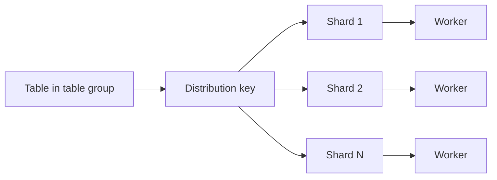

🗓️ 03022025 1236

# shard

> **Shard**: A data partition that the storage engine manages and workers process in parallel. ([Hologres documentation](https://www.alibabacloud.com/help/en/hologres/user-guide/basic-concepts))

A shard is a data partition. The storage engine manages one shard per engine instance, and workers process assigned shards in parallel. Persistent Hologres data is stored in Pangu; a shard is a logical data unit, not a physical disk.

## Shard placement

When a table is created, it is assigned to a [[table_group]]. Rows are assigned to shards using the [[distribution_key]], or distributed randomly when no key applies. Shards are spread across workers for parallel query execution.

Shard count affects parallelism and resource use. Use the current instance and table-group guidance when choosing a count; placement and recovery are managed by the service.

---
## References
- [Hologres: Table groups and shards](https://www.alibabacloud.com/help/en/hologres/user-guide/user-guide-of-table-groups-and-shard-counts)
- [Hologres: Concepts](https://www.alibabacloud.com/help/en/hologres/user-guide/basic-concepts)
