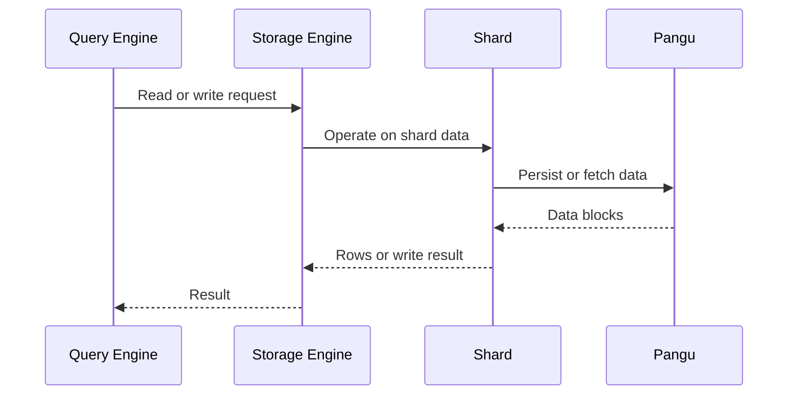

🗓️ 03022025 1344

# storage_engine

> **Storage Engine (SE)**: The Hologres worker component that manages data and CRUD operations for shards. ([Hologres documentation](https://www.alibabacloud.com/help/en/hologres/user-guide/basic-concepts))

- The **storage engine** in Hologres manages data on [[shard]] and provides CRUD  operations
- It is responsible for high-performance data writes and reads

## **Relationship with Shards**
- Each worker creates multiple storage engines, with each engine handling one shard.
- Storage engines are evenly distributed across workers to ensure balanced resource usage.

## **Performance Considerations**
- Proper configuration of shard counts and table groups ensures efficient resource allocation and high concurrency.
- Improper configuration can lead to uneven resource usage and performance degradation.

---
## References
- https://www.alibabacloud.com/help/en/hologres/user-guide/table-group-and-shard-count
