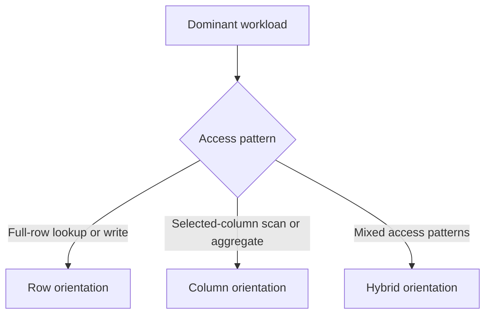

🗓️ 17102026 2135

# storage_modes

Hologres table orientation chooses how column values are physically organized for the table's workload.

| Term | Definition | Source |
|---|---|---|
| **Row-oriented storage** | Stores a row's values together, supporting workloads that access complete rows. | [Storage models](https://www.alibabacloud.com/help/en/hologres/user-guide/storage-models-of-tables) |
| **Column-oriented storage** | Stores values by column, supporting analytical scans over selected columns. | [Storage models](https://www.alibabacloud.com/help/en/hologres/user-guide/storage-models-of-tables) |
| **Row-column hybrid storage** | Combines row and column storage characteristics for mixed access patterns. | [Storage models](https://www.alibabacloud.com/help/en/hologres/user-guide/storage-models-of-tables) |

The supported orientations are `column`, `row`, and `row,column`. Column orientation suits scans over selected columns; row orientation suits primary-key lookups; hybrid orientation keeps row and column copies for mixed access patterns, with higher storage overhead. Orientation is selected at table creation and changing it later requires recreating the table. Confirm version and table restrictions before use.

```sql
CREATE TABLE example (...) WITH (orientation = 'column');
```

Older Hologres examples may set table properties through `set_table_property`. Prefer the current syntax and product documentation for the deployed release rather than combining examples from different versions.



For physical storage context, see [[storage_engine]]. For table design choices, see [[table_creation_best_practises]].

## References

- [Hologres: Storage models of tables](https://www.alibabacloud.com/help/en/hologres/user-guide/storage-models-of-tables)
