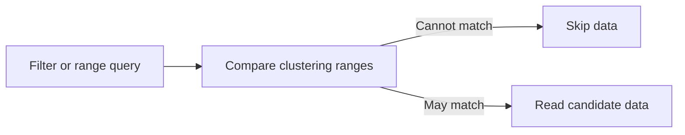

🗓️ 17102026 2218

# clustering_key

> **Clustering key**: A table property that orders data within files to reduce reads for matching filters. ([Hologres documentation](https://www.alibabacloud.com/help/en/hologres/user-guide/guide-on-scenario-specific-table-creation-and-tuning))

The clustering key organizes values inside a shard. It complements the [[distribution_key]], which chooses the shard, and the [[segment_key]], which helps Hologres prune files by event-time ranges.

## How it affects queries

The key orders data so a filter or range scan can narrow the data it reads. Multi-column keys follow a leftmost-prefix rule: queries benefit most when they filter the first key column, then subsequent columns in order.

This is useful for repeated point or range filters, but it adds a layout decision that should match real predicates. Clustering does not replace shard pruning, partition pruning, or event-time file pruning.

## Choosing a key

- Start with the most common selective filter or range column.
- For a composite key, put the most useful prefix first and keep the key short.
- Hologres imposes type, nullability, and ordering restrictions. These have changed across releases, so check the deployed version's [clustering-key guidance](https://www.alibabacloud.com/help/en/hologres/user-guide/guide-on-scenario-specific-table-creation-and-tuning).
- The key is configured at table creation. Changing it requires a replacement table and data migration.

For event-time ordering and file pruning, see segment_key. For the table properties together, see [[indexes]].

## References

- [Hologres: Best practices for table properties](https://www.alibabacloud.com/help/en/hologres/user-guide/guide-on-scenario-specific-table-creation-and-tuning)
- [Hologres: Create tables](https://www.alibabacloud.com/help/en/hologres/developer-reference/create-tables)
