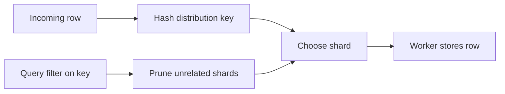

🗓️ 17102026 2218

# distribution_key

> **Distribution key**: A table property that places rows with the same key value on the same shard. ([Hologres documentation](https://www.alibabacloud.com/help/en/hologres/user-guide/distribution-key))

The distribution key chooses row placement across Hologres shards. It affects shard pruning, aggregation locality, and whether joins can run locally.

## How it affects queries

Rows with the same key value go to the same shard. A filter on the distribution key can let Hologres scan only relevant shards. A filter that does not identify shards can require work across the shard set.

If a `GROUP BY` uses the distribution key, each shard can aggregate its local rows before results are combined. For joins, data can stay local when both tables use the join columns as their distribution keys and belong to the same table group.

## Choosing a key

- Prefer a frequently used join or grouping column with evenly distributed values.
- Avoid low-cardinality or highly skewed values that concentrate work on few shards.
- Keep composite keys small; queries may need predicates on all key columns to benefit from pruning.
- If a table has a primary key, its distribution key must be the primary key or a subset. Hologres uses the primary key by default when a key is not specified.
- Without a primary key or explicit distribution key, rows are distributed randomly.

The key is a table-creation property. Changing it requires creating a replacement table and migrating data. Check current type restrictions and instance behavior in the version-specific [table property documentation](https://www.alibabacloud.com/help/en/hologres/developer-reference/create-tables).

For table-group constraints on local joins, see [[table_group]]. For the other data layout properties, see [[indexes]].

## References

- [Hologres: Distribution key](https://www.alibabacloud.com/help/en/hologres/user-guide/distribution-key)
- [Hologres: Create tables](https://www.alibabacloud.com/help/en/hologres/developer-reference/create-tables)
