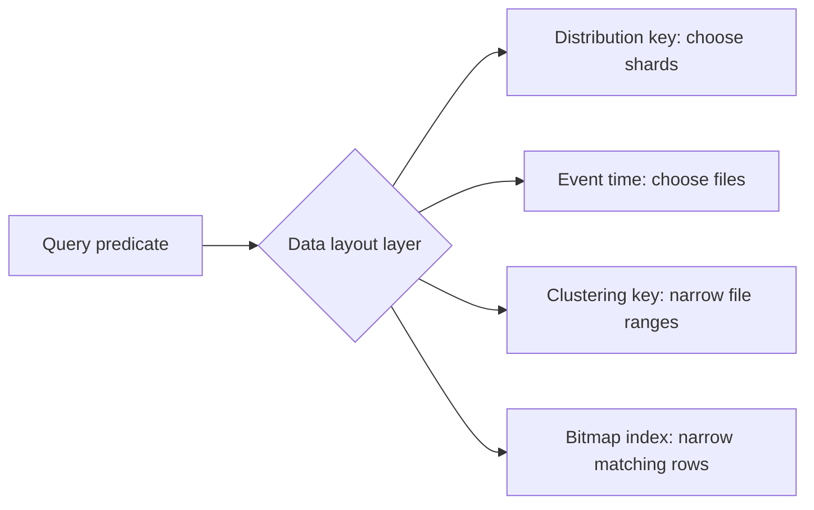

🗓️ 17102026 2135

# indexes

> **Bitmap index**: An index that maps distinct column values to matching rows, helping narrow single-value filters. ([Hologres documentation](https://www.alibabacloud.com/help/en/hologres/user-guide/guide-on-scenario-specific-table-creation-and-tuning))

In Hologres, table properties control where rows are distributed, how rows are organized within shards, and which extra indexes accelerate filters.

These settings are selected for query patterns and can have write, storage, and operational costs:

- [[distribution_key]] routes rows to shards and affects data locality for joins and lookups.
- [[clustering_key]] orders data within a shard to help range scans and filtering.
- [[segment_key]] is the older name for the event time column property; current DDL uses `event_time_column`.
- Bitmap indexes can narrow selected filters, with storage and write costs.

Do not configure every property by default. Start from the queries that matter, choose table orientation and distribution first, then evaluate clustering and secondary indexes with representative data. Some layout properties are fixed at table creation, so confirm which can be changed before committing to a schema.

For scenario-based table configuration, see [[table_creation_best_practises]]. For query plans and bottlenecks, see [[sql_optimization]]. For row, column, and hybrid storage, see [[storage_modes]].

## References

- [Hologres: Best practices for table properties](https://www.alibabacloud.com/help/en/hologres/user-guide/guide-on-scenario-specific-table-creation-and-tuning)
- [Hologres: Create tables](https://www.alibabacloud.com/help/en/hologres/developer-reference/create-tables)
