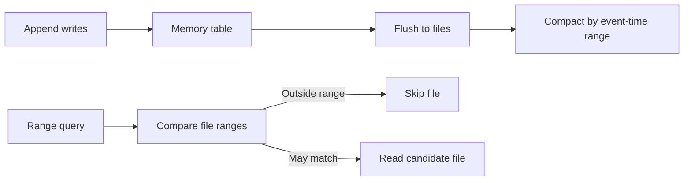

🗓️ 17102026 2218

# segment_key

> **Event time column**: A table property that helps Hologres locate files for filters on time-correlated data. Older documentation calls it the segment key. ([Hologres documentation](https://www.alibabacloud.com/help/en/hologres/user-guide/segment-key))

Hologres uses this property to organize and filter files within a shard. The note keeps the established name `segment_key`; current table DDL uses `event_time_column`.

## How it affects reads and writes

Writes first accumulate in memory and later flush to files. Background compaction groups files with nearby event-time ranges. For a query with a matching range predicate, Hologres can compare file statistics and skip files whose ranges cannot match.

The property can also help locate existing data during primary-key updates. It works best when values are strongly correlated with time and arrive in a useful order. Unordered values or unrelated filters may leave many files to scan.

## Choosing a column

- Choose a non-null timestamp or other supported column that tracks event time or update time.
- Prefer one column unless the query patterns clearly benefit from an ordered composite key.
- The key is configured at table creation. It cannot be changed in place.
- Row-oriented tables do not support this property. Type and nullability restrictions vary by release; check the current [event time column documentation](https://www.alibabacloud.com/help/en/hologres/user-guide/segment-key).
- In `EXPLAIN`, `Segment Filter` indicates that a query uses this pruning path.

For partition pruning above the shard and file levels, see [[sql_optimization]]. For within-file ordering, see [[clustering_key]].

## References

- [Hologres: Event time column (segment key)](https://www.alibabacloud.com/help/en/hologres/user-guide/segment-key)
- [Hologres: Get started with indexes](https://www.alibabacloud.com/help/en/hologres/getting-started/hologres-index-to-get-started-quickly)
