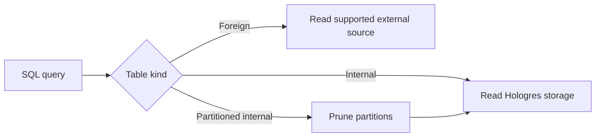

🗓️ 17102026 2135

# specific_tables

Hologres supports local tables for stored data and foreign tables that expose supported external data sources through SQL.

| Term | Definition | Source |
|---|---|---|
| **Foreign table** | A Hologres table definition that maps a supported external relation for SQL access. | [Create foreign tables](https://www.alibabacloud.com/help/en/hologres/developer-reference/create-foreign-table) |
| **Partitioned table** | A table whose rows are split into partitions using a partition key. | [Create tables](https://www.alibabacloud.com/help/en/hologres/developer-reference/create-tables) |

## Partitioned tables

A partitioned table divides rows by a partition key, often a date or tenant boundary. Queries can read only relevant partitions when their predicates match the partition scheme. Partitioning helps data lifecycle management and pruning; it does not guarantee a faster query if the planner still needs to scan many partitions or files.

## Foreign tables

A foreign table maps an external relation into Hologres so queries can access supported sources without first copying all data into a local table. The source-specific foreign server, formats, predicates, and pushdown support vary by integration. Remote scans can have different latency and throughput from local storage, so check the source documentation and query plan.

Use a foreign table when source data freshness or avoiding a copy matters. Materialize data locally when repeated queries, predictable performance, or local indexing justify the storage and refresh cost.

For Hologres workload context, see [[product_overview]]. To persist query results, see [[materialized_view]]. For local table layout choices, see [[storage_modes]].

## References

- [Hologres: Create foreign tables](https://www.alibabacloud.com/help/en/hologres/developer-reference/create-foreign-table)
- [Hologres: Create tables](https://www.alibabacloud.com/help/en/hologres/developer-reference/create-tables)
