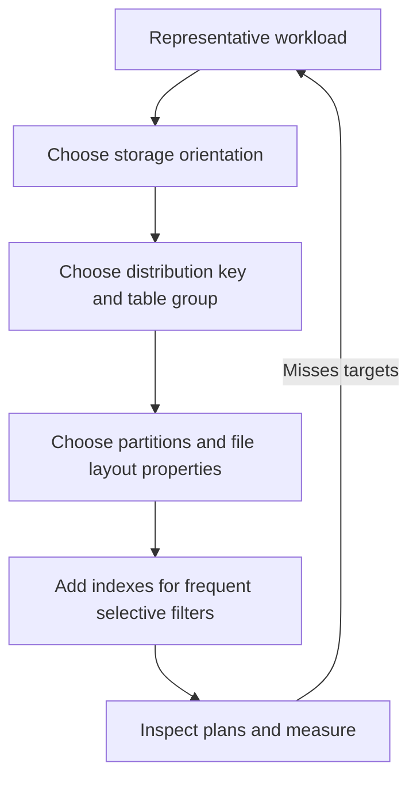

🗓️ 17102026 2222

# table_creation_best_practises

Choose table properties from the queries and writes the table must serve. No single orientation, key, or shard count fits every workload.

## Design sequence

1. Identify the dominant query patterns: point lookups, joins, aggregations, scans, or a mix.
2. Choose [[storage_modes]] for the columns and rows each query reads.
3. Choose a [[distribution_key]] that balances data and aligns with frequent joins or groupings. Put tables that need local joins in the same [[table_group]].
4. Add partitioning, [[segment_key]], [[clustering_key]], or bitmap indexes only when query predicates can use them.
5. Inspect `EXPLAIN` output and measure representative read and write workloads.

Shard count depends on instance specifications and workload. Follow the current [table-group and shard guidance](https://www.alibabacloud.com/help/en/hologres/user-guide/user-guide-of-table-groups-and-shard-counts); row count alone does not determine an appropriate setting.

## References

- [Hologres: Best practices for table properties](https://www.alibabacloud.com/help/en/hologres/user-guide/guide-on-scenario-specific-table-creation-and-tuning)
- [Hologres: Create tables](https://www.alibabacloud.com/help/en/hologres/developer-reference/create-tables)
- [Hologres: Table groups and shards](https://www.alibabacloud.com/help/en/hologres/user-guide/user-guide-of-table-groups-and-shard-counts)
