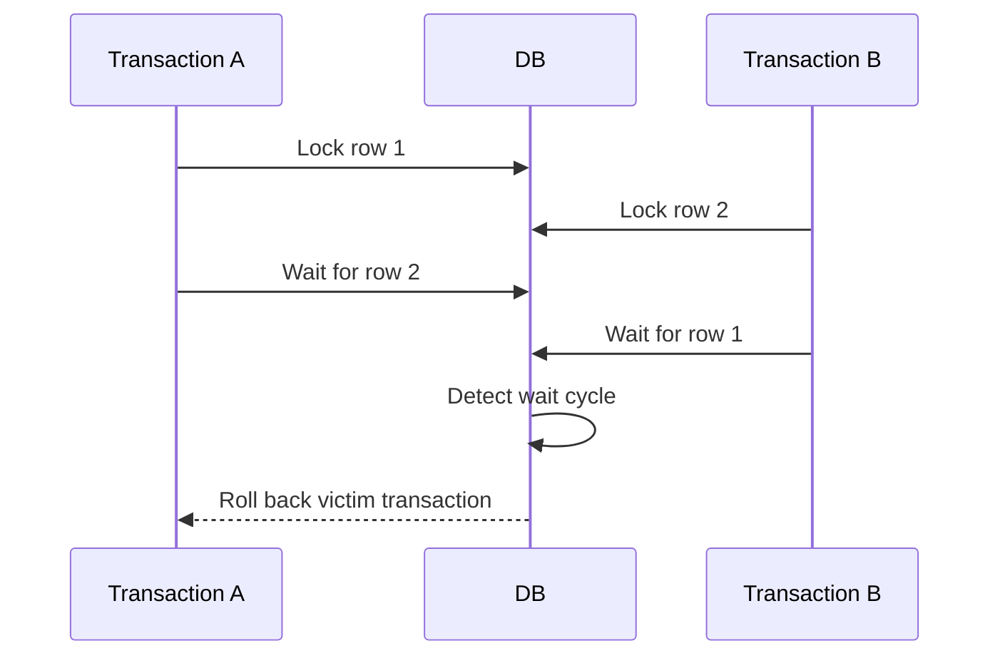

🗓️ 17102026 2135

# innodb_deadlocks

An InnoDB deadlock occurs when transactions form a cycle: each holds a lock needed by another transaction in the cycle.

InnoDB detects deadlocks by default and rolls back one victim so the others can continue. Applications must treat a deadlock rollback as a retryable transaction failure. Retry the whole transaction with bounded backoff, not just the last statement, and make the transaction safe to rerun.

## Reading a deadlock report

`SHOW ENGINE INNODB STATUS` shows the latest detected deadlock. Look for:

1. Each transaction's SQL and transaction state.
2. Locks each transaction **holds**.
3. Locks each transaction is **waiting for**.
4. The cycle connecting those holds and waits.
5. The selected victim.

Index records and gaps are the objects InnoDB locks. Two statements with different `WHERE` values can still contend because of their access paths, foreign-key checks, secondary-index maintenance, or ranges scanned. But proximity of values alone does not prove that range locks overlap.

An earlier production report showed two concurrent `UPDATE` statements waiting in the same secondary index, with one transaction selected as victim. The saved excerpt did not include the complete set of locks held by each transaction, the index definition, or the query plan, so it is not sufficient to reconstruct the exact cycle. Treat any more specific explanation as a hypothesis until the full lock graph is available.

## Reducing recurrence

- Keep transactions short and access multiple rows or tables in a consistent order.
- Add or adjust indexes so statements scan fewer records; check `EXPLAIN`.
- Review predicates, foreign keys, and secondary-index updates in the workload.
- Handle deadlock errors by retrying the complete transaction when safe.
- Use `SHOW ENGINE INNODB STATUS`; enable `innodb_print_all_deadlocks` temporarily when more reports are needed.

Changing isolation level is not a general deadlock fix. MySQL notes that deadlocks arise from write-lock conflicts and are not prevented simply by lowering isolation; measure the effect on correctness and contention before changing it.

For lock records, gaps, and next-key ranges, see [[innodb_locks]]. For snapshot and locking-read behavior, see [[innodb_isolation_levels]]. For conflict detection without holding locks throughout work, see [[optimistic_locking]].

## References

- [MySQL 8.4: Deadlocks in InnoDB](https://dev.mysql.com/doc/refman/8.4/en/innodb-deadlocks.html)
- [MySQL 8.4: Minimizing and handling deadlocks](https://dev.mysql.com/doc/refman/8.4/en/innodb-deadlocks-handling.html)
