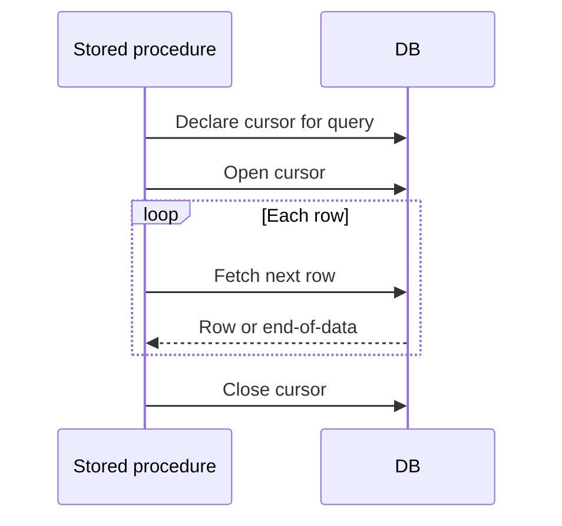

🗓️ 01102024 0944

# cursor

MySQL supports cursors in stored programs and server-side prepared statements. Stored-program cursors are forward-only and read-only; behavior differs from cursor types supported by other databases.

## Stored-program cursor properties

- **Asensitive:** MySQL may or may not copy the result table.
- **Read-only:** A cursor cannot update the current row.
- **Nonscrollable:** Fetch moves forward; it cannot jump to arbitrary rows.
- **Nonholdable:** A cursor does not remain open after commit.

Stored-program declarations have an order: local variables first, then cursors, then handlers. A `NOT FOUND` handler detects the end of the result. See [[cursor_lifecycle]] for a complete example.

MySQL's server-side prepared-statement cursors materialize results in an internal temporary table. Large results can therefore incur memory or disk I/O costs. See [[database_cursor]] for the broader concept.

## References

- [MySQL 8.4: Cursors](https://dev.mysql.com/doc/refman/8.4/en/cursors.html)
- [MySQL 8.4: Server-side cursor restrictions](https://dev.mysql.com/doc/refman/8.4/en/cursor-restrictions.html)
