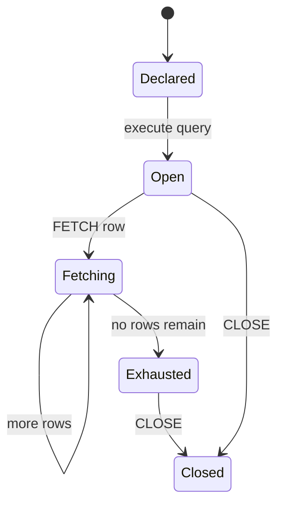

🗓️ 02102024 1035

# cursor_lifecycle

A MySQL stored-program cursor is declared with a query, opened, fetched until a `NOT FOUND` condition, then closed. Declarations must appear at the start of the `BEGIN ... END` block in the required order.



## Example

```sql
CREATE PROCEDURE read_users()
BEGIN
  DECLARE done BOOLEAN DEFAULT FALSE;
  DECLARE user_id BIGINT;
  DECLARE user_name VARCHAR(255);
  DECLARE users CURSOR FOR
    SELECT id, name FROM user_account;
  DECLARE CONTINUE HANDLER FOR NOT FOUND SET done = TRUE;

  OPEN users;
  read_loop: LOOP
    FETCH users INTO user_id, user_name;
    IF done THEN
      LEAVE read_loop;
    END IF;

    -- Apply procedural work to this row.
  END LOOP;
  CLOSE users;
END;
```

The handler runs when `FETCH` has no row. `CLOSE` releases the cursor. MySQL stored-program cursors do not use a separate `DEALLOCATE` statement.

The example shows lifecycle mechanics only. Use a set-based statement when it can express the same transformation more simply.

## References

- [MySQL 8.4: Cursors](https://dev.mysql.com/doc/refman/8.4/en/cursors.html)
- [[cursor]]
