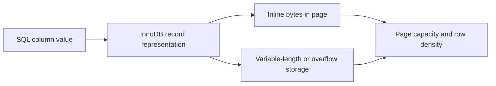

🗓️ 17102026 2135

# column_data_size

MySQL column type sizes describe value representation; they are not a complete estimate of table or index disk usage.

## Common InnoDB value sizes

| Type | Storage for the value | Notes |
|---|---:|---|
| `TINYINT` / `SMALLINT` / `MEDIUMINT` | 1 / 2 / 3 bytes | Signedness changes range, not width. |
| `INT` / `BIGINT` | 4 / 8 bytes | Fixed-width integers. |
| `FLOAT` / `DOUBLE` | 4 / 8 bytes | Approximate numeric types. |
| `DECIMAL(M,D)` | Variable | Nine decimal digits use four bytes; leftover digits use 0–4 bytes per group. |
| `DATE` | 3 bytes | `TIME`, `DATETIME`, and `TIMESTAMP` add 0–3 bytes for fractional seconds. |
| `VARCHAR` / `VARBINARY` | value bytes + 1 or 2 bytes | Depends on maximum possible byte length and actual encoded length. |
| `TEXT` / `BLOB` families | value bytes + 1–4 bytes | Prefix width depends on the family; row-format rules affect off-page storage. |

These are type-level guidelines. For character columns, the stored byte length depends on character set and actual characters. `CHAR` behavior also depends on character set and InnoDB row format. `JSON` uses a binary representation; its space depends on document structure and is not equal to the input text length.

## Why table size is larger

An InnoDB row also has record metadata, null and variable-length information, and page-level overhead. Long variable-length values may be stored partly or fully off-page depending on row format and value size. Compression and free space further affect allocated pages.

InnoDB stores rows in the clustered primary-key index. Secondary-index records include the primary-key columns needed to find the clustered row, so wide primary keys increase every secondary index. A rough estimate based only on key bytes and a fixed pointer size is unreliable.

For a real estimate, create representative rows with realistic encodings, build the required indexes, and compare `DATA_LENGTH` and `INDEX_LENGTH` or inspect table statistics. Account for growth, page fill, and engine metadata.

For index structure and row lookup, see [[b_plus_tree_indexes]]. For composite index layout, see [[composite_index_leftmost_prefix]]. For primary-key and index effects on locking, see [[innodb_locks]].

## References

- [MySQL 8.4: Data Type Storage Requirements](https://dev.mysql.com/doc/refman/8.4/en/storage-requirements.html)
- [MySQL 8.4: InnoDB File Space Management](https://dev.mysql.com/doc/refman/8.4/en/innodb-file-space.html)
- [MySQL 8.4: InnoDB Query Optimization](https://dev.mysql.com/doc/refman/8.4/en/optimizing-innodb-queries.html)
