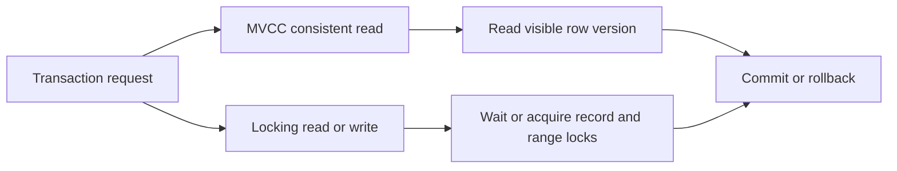

🗓️ 17102026 2135

# innodb_concurrency_control

InnoDB coordinates concurrent transactions with MVCC, record and range locks, and undo history.

For a consistent nonlocking read, InnoDB uses a read view to decide which committed row version is visible. Updates and locking reads may wait for or acquire locks. The exact locks depend on the statement, index access path, isolation level, and transaction state; an index can therefore affect both performance and the lock footprint.

MVCC does not mean that transactions never block. Writes to conflicting records, locking reads, foreign-key checks, and other operations can contend. Diagnose a stall by inspecting active transactions and lock-wait information, then check the query plan and indexes involved.

For visibility of row versions, see [[mvcc_innodb_read_view]]. For record and range locks, see [[innodb_locks]]. For detecting and resolving deadlocks, see [[innodb_deadlocks]]. For isolation behavior, see [[innodb_isolation_levels]].

## References

- [MySQL 8.4: InnoDB multi-versioning](https://dev.mysql.com/doc/refman/8.4/en/innodb-multi-versioning.html)
- [MySQL 8.4: InnoDB locking](https://dev.mysql.com/doc/refman/8.4/en/innodb-locking.html)
