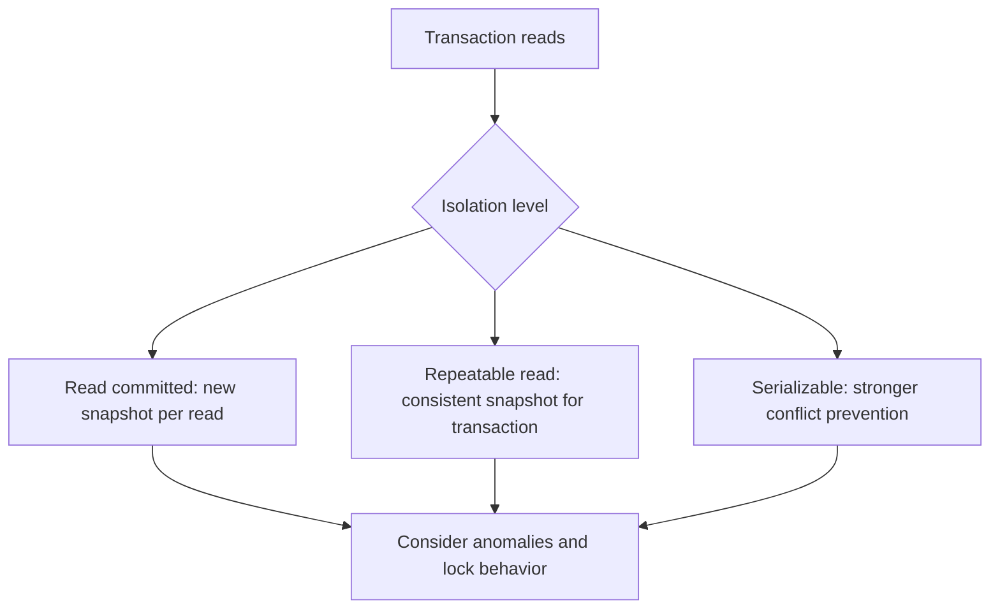

🗓️ 17102026 2135

# innodb_isolation_levels

InnoDB implements the SQL isolation levels with a mix of MVCC snapshots and locks; the level alone does not describe every statement's behavior.

## The practical differences

- **READ UNCOMMITTED:** permits dirty reads. InnoDB still uses locking for writes.
- **READ COMMITTED:** each consistent read gets a fresh snapshot. For locking reads and writes, InnoDB releases locks on nonmatching rows after evaluating the `WHERE` condition, except for cases such as foreign-key and duplicate-key checks.
- **REPEATABLE READ:** InnoDB's default. Plain consistent reads in a transaction use the snapshot established by the first consistent read. Locking reads and writes use locks on records and, for range searches, may use gap or next-key locks.
- **SERIALIZABLE:** strengthens transaction behavior; for InnoDB, plain `SELECT` statements are implicitly converted to `SELECT ... FOR SHARE` when autocommit is disabled.

The important distinction is between a **consistent read** and a **current locking read**. Mixing them in one transaction can show different database views. Index choice and search range affect lock scope, so isolation changes can alter both concurrency and blocking.

For sQL-level overview and engine differences, see [[isolation_levels]]. For snapshot visibility, see [[mvcc_innodb_read_view]]. For lock types and ranges, see [[innodb_locks]]. For repeated reads under `READ COMMITTED`, see [[innodb_read_inconsistency]].

## References

- [MySQL 8.4: InnoDB Transaction Isolation Levels](https://dev.mysql.com/doc/refman/8.4/en/innodb-transaction-isolation-levels.html)
