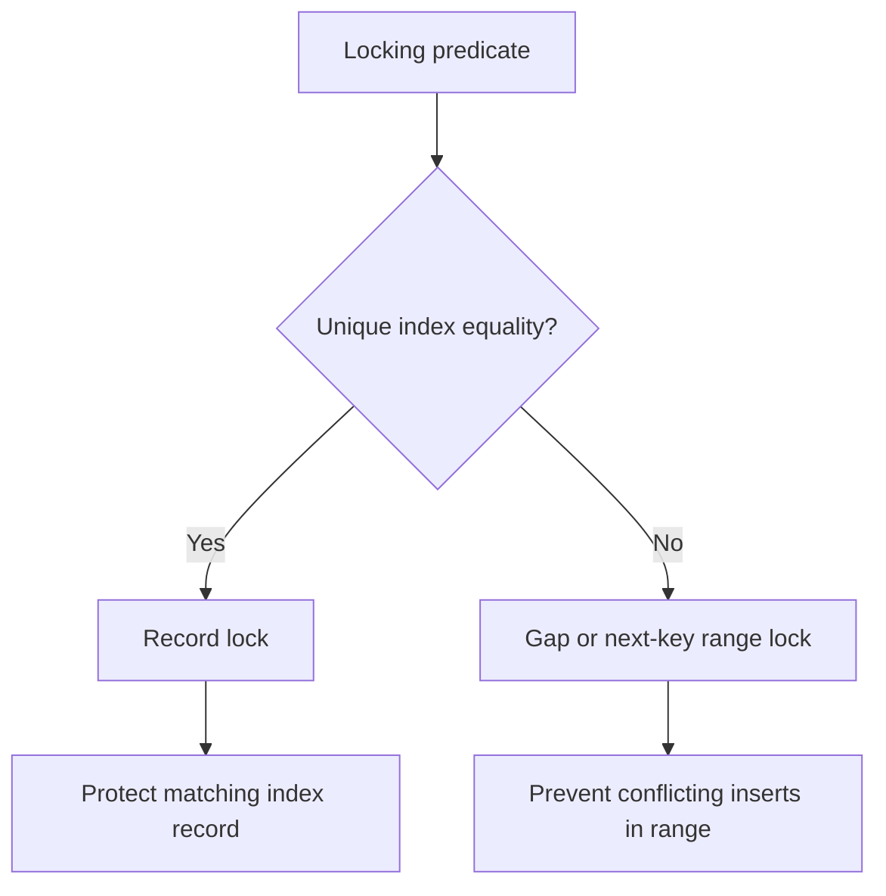

🗓️ 02032025 0119

# innodb_locks

InnoDB locks index records and ranges so concurrent transactions can coordinate changes. The lock is often described as a “row lock,” but InnoDB implements it on index records. The query plan and index scanned therefore affect which records or gaps are locked.

## Record and range locks

- **Record lock:** locks an index record. A transaction that updates or deletes a row takes exclusive locks on the relevant index records; a locking read can request shared or exclusive locks.
- **Gap lock:** locks the gap between index records, or the gap before the first or after the last record. It blocks inserts into that gap, but does not lock an existing record by itself.
- **Next-key lock:** combines a record lock with the gap before it. InnoDB commonly uses next-key locking for searches and index scans under `REPEATABLE READ` to prevent inserts that would change the scanned range.

For example, an indexed locking range scan such as `SELECT ... WHERE age > 30 FOR UPDATE` can lock records and gaps it scans. The exact lock set depends on the index and execution plan; a broad or unindexed scan can lock far more than the rows returned. Under `READ COMMITTED`, InnoDB generally disables gap locking for searches and scans, with documented exceptions such as foreign-key and duplicate-key checks.

Ordinary consistent `SELECT` statements are normally nonlocking MVCC reads. An exclusive row lock does not simply prohibit every other transaction from reading the old committed version; conflicting writes and locking reads wait or fail according to the transaction and timeout behavior.

## Intention and table locks

Before taking a shared or exclusive record lock, InnoDB sets a corresponding table-level intention lock (`IS` or `IX`). These locks announce the transaction’s intent and let InnoDB detect conflicts with table-level locks. Intention locks do not themselves lock every row or prevent other transactions from locking different records.

Explicit table locks (`LOCK TABLES`) are a separate SQL mechanism. Do not treat them as the routine way InnoDB performs bulk updates: ordinary DML uses record and range locks, plus intention locks. InnoDB also uses internal table-level locks for coordination, including metadata-related operations.

## AUTO_INCREMENT coordination

Inserts into an `AUTO_INCREMENT` column use an auto-increment mechanism to allocate values. Its behavior depends on `innodb_autoinc_lock_mode` and the statement type. The mechanism coordinates allocation; it is not a general-purpose guarantee that every possible insert receives globally gapless IDs. Rollbacks and failed inserts can leave gaps.

## Practical way to reason about a lock wait

1. Identify the statement and transaction isolation level.
2. Check the chosen index and rows/ranges scanned, not just rows returned.
3. Inspect the lock wait or deadlock report to find the conflicting index records and transactions.
4. Reduce unnecessary scan ranges, keep transactions short, and retry a transaction chosen as a deadlock victim when the operation is safe to retry.

## References

- [MySQL 8.4: InnoDB locking](https://dev.mysql.com/doc/refman/8.4/en/innodb-locking.html)
- [MySQL 8.4: Locks set by SQL statements](https://dev.mysql.com/doc/refman/8.4/en/innodb-locks-set.html)
- [MySQL 8.4: AUTO_INCREMENT handling in InnoDB](https://dev.mysql.com/doc/refman/8.4/en/innodb-auto-increment-handling.html)
