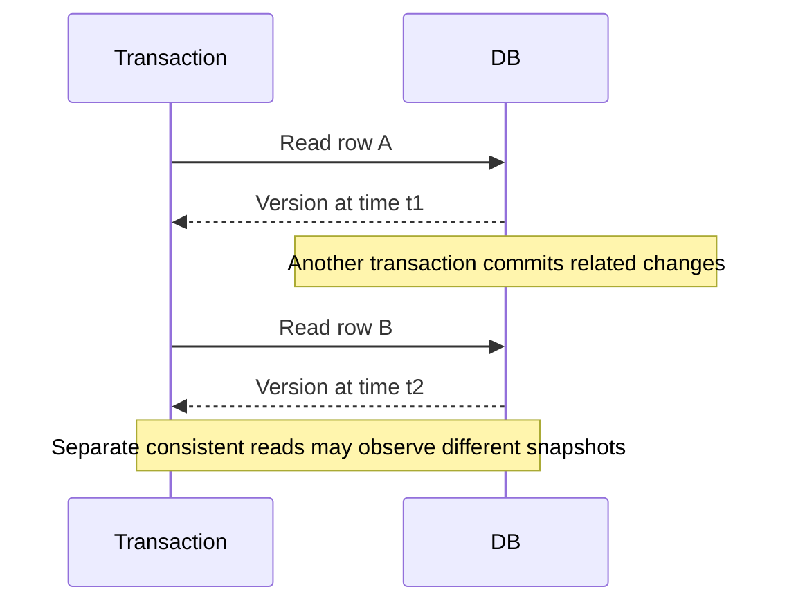

🗓️ 17102026 2135

# innodb_read_inconsistency

In MySQL InnoDB, separate consistent reads in `READ COMMITTED` can observe different committed snapshots within one transaction.

For example, transaction A reads an account balance. Transaction B updates and commits it. If A reads that row again, the second plain `SELECT` can see B's value. This is a non-repeatable read. A repeated range query can also include a newly committed matching row, a phantom read.

These are behaviors permitted by `READ COMMITTED`, not corruption or violations of the database's consistency rules. Use a stronger isolation level or explicit locking when the operation requires a stable view or coordination. Lower isolation is not a general deadlock fix: deadlocks depend on conflicting lock acquisition, query plans, and transaction ordering.

InnoDB's `REPEATABLE READ` consistent reads use a transaction snapshot, while locking reads and writes use locks against current records and ranges. Mixing snapshot reads with locking operations can therefore expose different views; design the transaction around one intended access pattern.

For mySQL isolation semantics, see [[innodb_isolation_levels]]. For snapshot visibility, see [[mvcc_innodb_read_view]]. For lock-cycle failures, see [[innodb_deadlocks]].

## References

- [MySQL 8.4: Transaction Isolation Levels](https://dev.mysql.com/doc/refman/8.4/en/innodb-transaction-isolation-levels.html)
- [MySQL 8.4: Consistent Nonlocking Reads](https://dev.mysql.com/doc/refman/8.4/en/innodb-consistent-read.html)
