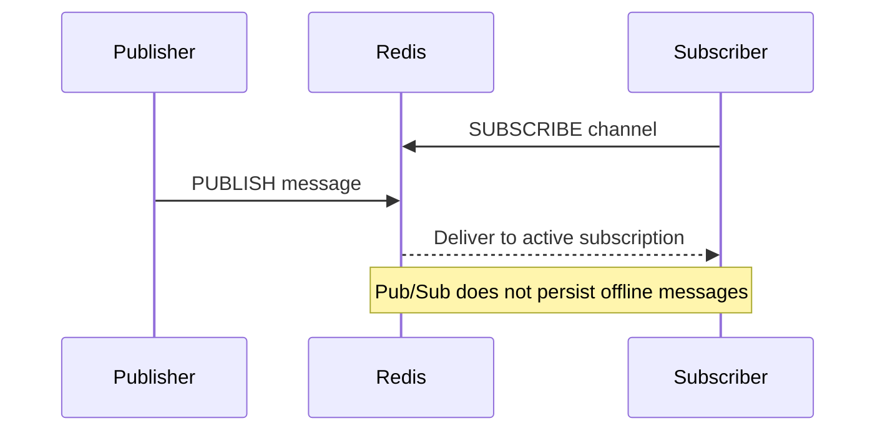

🗓️ 17102026 2135

# message_subscription

Redis Pub/Sub pushes published messages to clients that are subscribed at that moment.

A publisher sends a message to a channel with `PUBLISH`; subscribers use `SUBSCRIBE` or pattern subscriptions to receive pushes over their Redis connection. Multiple clients can subscribe to the same channel, so Pub/Sub provides fan-out without each publisher tracking each consumer.

Pub/Sub is **at-most-once**: a disconnected or slow subscriber can miss a message, and Redis does not retain it for later replay. Use Pub/Sub for transient notifications where missed messages can be tolerated or repaired from another source. Use [[queue]] or Redis Streams when consumers need retained messages, replay, or stronger delivery workflows.

```text
Publisher -> PUBLISH orders:updated -> Redis -> active subscribers
                                      (no durable backlog)
```

For broader messaging models, see [[moc_messaging]].



## References

- [Redis: Pub/Sub](https://redis.io/docs/latest/develop/pubsub/)
