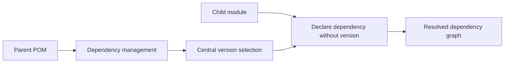

🗓️ 17102026 2135

# bill_of_materials

A Maven Bill of Materials (BOM) is a POM that centralizes managed dependency versions.

Import it inside `<dependencyManagement>` with `type` set to `pom` and `scope` set to `import`. This lets a project declare managed artifacts without repeating their versions. Dependency management supplies version and related metadata; it does not add every listed artifact to the classpath by itself. The project still declares the dependencies it uses.

```xml
<dependencyManagement>
  <dependencies>
    <dependency>
      <groupId>org.example</groupId>
      <artifactId>example-bom</artifactId>
      <version>1.2.3</version>
      <type>pom</type>
      <scope>import</scope>
    </dependency>
  </dependencies>
</dependencyManagement>
```

If imported BOMs manage the same artifact, ordering and local declarations can affect which version wins. Check Maven's effective POM when the resolved version is surprising.

For dependency scope behavior, see [[maven_scope]].



## References

- [Maven: Introduction to the Dependency Mechanism](https://maven.apache.org/guides/introduction/introduction-to-dependency-mechanism.html)
