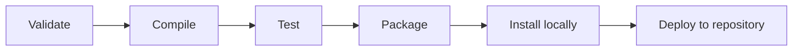

🗓️ 17102026 2135

# maven_phase

A Maven lifecycle is an ordered sequence of phases; invoking a phase runs earlier phases in that lifecycle first.

The **default** lifecycle includes phases such as `validate`, `compile`, `test`, `package`, `verify`, `install`, and `deploy`. For example, `mvn package` runs the earlier default-lifecycle phases before producing the packaged artifact. `clean` and `site` belong to separate lifecycles.

Plugins bind goals to phases. A POM can use a plugin's default bindings or add an execution with a chosen phase and goal:

```xml
<execution>
  <id>example-check</id>
  <phase>verify</phase>
  <goals><goal>check</goal></goals>
</execution>
```

Use the last phase that matches the required outcome: `test` for unit tests, `package` for a distributable artifact, or `verify` when integration checks and quality checks must complete. Exact plugin bindings depend on packaging and plugin configuration.

For dependency classpath behavior, see [[maven_scope]]. For dependency version management, see [[bill_of_materials]].



## References

- [Maven: Introduction to the Build Lifecycle](https://maven.apache.org/guides/introduction/introduction-to-the-lifecycle.html)
