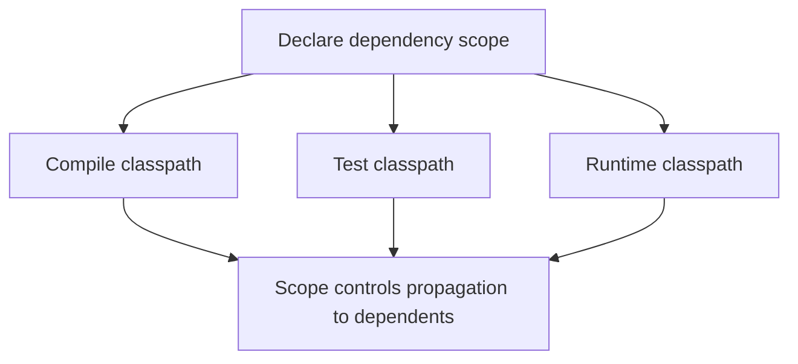

🗓️ 17102026 2135

# maven_scope

A Maven dependency's scope controls which classpaths include it and how it participates in downstream dependency resolution.

| Scope | Compile | Test | Runtime | Transitive |
|---|---:|---:|---:|---:|
| `compile` (default) | Yes | Yes | Yes | Yes |
| `provided` | Yes | Yes | No | No |
| `runtime` | No | Yes | Yes | Yes |
| `test` | No | Yes | No | No |
| `system` | Yes | Yes | Yes | No |

Use `provided` for an API supplied by the deployment environment, `runtime` for an implementation needed only when the application runs, and `test` for test-only libraries. Maven's `system` scope points to a local filesystem path and is generally discouraged because it makes builds machine-dependent.

`import` is a special scope for a POM dependency inside `<dependencyManagement>`; it imports managed dependency declarations rather than adding a library to the classpath. See [[bill_of_materials]].

For build lifecycle phases, see [[maven_phase]].

## References

- [Maven: Introduction to the Dependency Mechanism](https://maven.apache.org/guides/introduction/introduction-to-dependency-mechanism.html)
