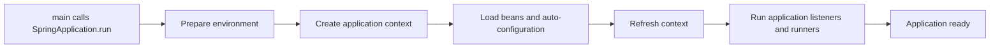

🗓️ 31052024 1426

# boot_application_lifecycle

## Run

> `SpringApplication.run()` triggers application lifecycle

## Bootstrap

- Creates an appropriate `ApplicationContext` instance.
- Loads application context with beans.

## Environment Preparation

- Loads and configures properties (e.g. `application.properties` / `application.yml`)
- Calls `EnvironmentPostProcessor` to customise environment (properties / profiles) before beans are processed

## Context Preparation

- Calls `ApplicationContextInitializer`
- Prepares `ApplicationContext`

## Context Refresh

- Loads all bean definitions
- Refresh `ApplicationContext`

## Application Running

- Calls `CommandLineRunner` and `ApplicationRunner` beans.

## Shutdown Phase

- For graceful shutdown
- Calls `DisposableBean` / `@PreDestroy` annotated methods

---

## References

- https://reflectoring.io/spring-bean-lifecycle/
- ChatGeePeeTee
